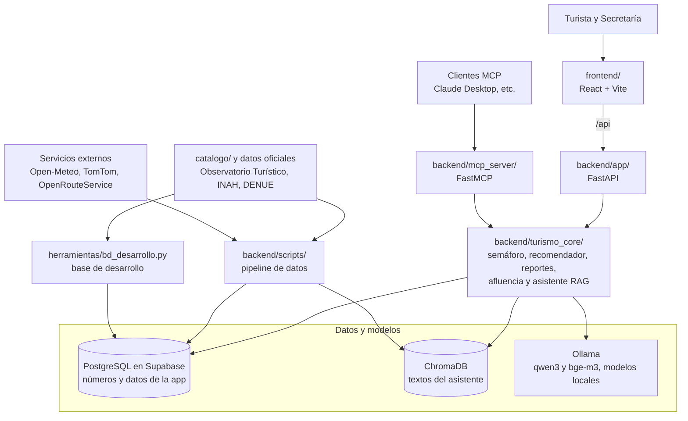

# RUMBO

**RUMBO** (Redistribución Unificada con Mapas, Búsquedas y Opiniones) es el repositorio del proyecto final de dos materias de la Universidad Iberoamericana Puebla. Cada materia tiene su propio equipo, entregables y documentación:

| Materia                                                                                                          | Docente                         | Equipo                                                                                                                             | Documentación            |
| ---------------------------------------------------------------------------------------------------------------- | ------------------------------- | ---------------------------------------------------------------------------------------------------------------------------------- | ------------------------ |
| **Interacción Persona Máquina** (13009A-O26). Tema del curso: *Interfaces Inteligentes para el Bienestar Social* | Dra. Gabriela A. Rodríguez Ruiz | Angel Rugerio Jiménez (201720), Axel García Arellano (201251), Diego Navarro Sánchez (202497) y Yohualli Ollin Luna Reyes (189670) | [`docs/HCI/`](docs/HCI/) |
| **Diseño de Software**                                                                                           | Mtro. Rafael Pérez Aguirre      | El mismo equipo y Cristian Alexei Romero Martínez (203739)                                                                         | [`docs/DdS/`](docs/DdS/) |

## De qué va

**RUMBO** responde *"¿a dónde voy ahora?"*: un semáforo en vivo de 23 lugares turísticos de Puebla, Cholula y Atlixco (buen momento / con precaución / mejor después). Si el lugar que buscas está lleno, te recomienda otro parecido y más tranquilo. También tiene un asistente con IA local que responde solo con los datos de la app, y un panel para la Secretaría de Turismo. La app nació en un hackathon. En este proyecto **rediseñamos su interfaz y funcionamiento con los principios de las materias** para que la pueda usar cualquier turista de la **mejor forma posible**.

## Cómo está construido



- **El frontend no tiene datos propios:** todo lo pide a la API.
- **La lógica vive en una sola capa:** FastAPI y el servidor MCP solo traducen hacia `turismo_core`, así que los dos responden lo mismo.
- **El estado actual, según el código:** la base es PostgreSQL en Supabase (`rumbo-dev` para desarrollo, `rumbo-demo` para la demo) y no hay login; la app identifica a cada turista con una sesión anónima y el panel de la Secretaría está abierto. Lo que cambiará por Diseño de Software está en la sección [Qué aporta cada materia](#qué-aporta-cada-materia).

## Estructura

```text
RUMBO/
├── README.md          # este archivo
├── INSTALACION.md     # cómo correr el proyecto en Windows y Linux
├── .gitignore         # secretos, datos crudos, bases regenerables y dependencias
├── backend/           # API, lógica de negocio, servidor MCP, pipeline de datos y pruebas
├── frontend/          # app del turista y panel de la Secretaría
├── catalogo/          # los 23 lugares de la zona piloto
├── herramientas/      # script que crea la base de desarrollo
└── docs/              # documentación por materia y del hackathon
    ├── HCI/           # instrucciones, propuesta y avances 1 a 3 (PDF)
    ├── DdS/           # instrucciones, ficha, pre-registro y estado de requisitos
    ├── hackathon/     # las 18 notas del hackathon (00 a 14)
    ├── 00 - Calendario ExpoIbero.png
    └── 01 - Instrucciones Pre-registro.png
```

| Elemento                   | Qué es y para qué sirve                                                                                                                                            | Más detalle                                |
| -------------------------- | ------------------------------------------------------------------------------------------------------------------------------------------------------------------ | ------------------------------------------ |
| `backend/`                 | API en **FastAPI**, `turismo_core` (semáforo, recomendador, reportes y asistente), servidor MCP, pipeline de datos y pruebas. Usa Python, `uv`, PostgreSQL (Supabase) y ChromaDB  | [`backend/README.md`](backend/README.md)   |
| `frontend/`                | La app en **React 19 + Vite**: pantalla del turista, panel de la Secretaría y "Acerca de"                                                                          | [`frontend/README.md`](frontend/README.md) |
| `catalogo/`                | CSV con los 23 lugares: es la fuente de la tabla `punto` y de las fichas que usa el asistente                                                                      | [`catalogo/README.md`](catalogo/README.md) |
| `herramientas/`            | `bd_desarrollo.py`: crea la base de desarrollo sin claves ni datos crudos                                                                                          | [`herramientas/README.md`](herramientas/README.md) |
| `docs/`                    | Documentación de cada materia y del hackathon, con el calendario de la Expo Ibero y las instrucciones de su pre-registro                                           | [`docs/DdS/README.md`](docs/DdS/README.md) |
| `INSTALACION.md`           | Instalación, modos de ejecución, pruebas en celulares y problemas conocidos                                                                                        | [`INSTALACION.md`](INSTALACION.md)         |

Git no incluye `backend/.env`, `backend/data/raw/`, `backend/data/chroma/`, `frontend/dist/` ni `frontend/webDesignInspo/`: son secretos, datos oficiales, archivos que se regeneran o referencias con derechos de autor.

### Cómo leer las referencias del código

El código viene del hackathon y sus comentarios usan estas referencias:

| En el código                | Qué significa                                                                                                                       | Dónde está                                                                                                |
| --------------------------- | ----------------------------------------------------------------------------------------------------------------------------------- | --------------------------------------------------------------------------------------------------------- |
| `docs/05`, `docs/10`…       | Notas del hackathon. Hoy están en `docs/hackathon/`                                                                                 | [`docs/hackathon/`](docs/hackathon/)                                                                      |
| `RN_xx`, `RNF_xx`, `CU_xx`  | Reglas de negocio, requisitos no funcionales y casos de uso                                                                         | [`docs/hackathon/10 - Análisis FIS.md`](docs/hackathon/10%20-%20An%C3%A1lisis%20FIS.md)                   |
| `T1`…`T6`, `G1`             | Pantallas y tareas del turista (`T`) y del gobierno (`G`)                                                                           | [`docs/hackathon/12 - Especificación del frontend.md`](docs/hackathon/12%20-%20Especificaci%C3%B3n%20del%20frontend.md) |
| `D1`…`D6`                   | Decisiones de la propuesta de HCI: letra, forma, color, barra lateral, botones grandes y teclado                                     | [`docs/HCI/00 - Propuesta.pdf`](docs/HCI/00%20-%20Propuesta.pdf)                                          |
| `puebla_*`, `PUEBLA_*` | Nombres heredados del hackathon. Siguen vigentes en herramientas MCP y variables de entorno                                      | [`backend/README.md`](backend/README.md)                                                                  |

## Cómo correrlo

La guía completa, para Windows y Linux, está en [`INSTALACION.md`](INSTALACION.md). Hay dos modos:

- **Desarrollo:** para trabajar en la interfaz en cualquier computadora. Usa `rumbo-dev`, la base compartida del equipo en Supabase, cargada con [`herramientas/bd_desarrollo.py`](herramientas/bd_desarrollo.py) a partir de los datos procesados del repositorio. Necesita `backend/.env` con su URL (se pide al equipo) e internet; no necesita `data/raw/`.
- **Datos reales:** para la demo, la presentación y las pruebas con usuarios. Usa `rumbo-demo`; necesita su `backend/.env`, `backend/data/raw/` (se copia a mano) y Ollama para el asistente.

Inicio rápido en modo de desarrollo (Linux; en Windows, ver la guía):

```bash
cd backend && uv sync
cp .env.example .env                                # y pon la URL de rumbo-dev (INSTALACION.md, paso 3.1)
PUEBLA_TAREAS=0 uv run uvicorn app.main:app --reload --port 8000
```
```bash
cd frontend && npm ci && npm run dev                # en otra terminal → http://localhost:5173
```

Requisitos: Python ≥ 3.12 con [`uv`](https://docs.astral.sh/uv/), Node ≥ 22.12 y, para el asistente, [Ollama](https://ollama.com) con `bge-m3` y `qwen3:8b` (o `qwen3:4b` en una laptop con poca memoria de video).

## Qué aporta cada materia

### DdS

Aplicando los conocimientos de la clase, se busca hacer lo siguiente:
- **Login:** con 2 roles (turista y administrador)
- **Datos con dueño**
- **Regla de la base**
- **Lógica en capas:** con pruebas de funcionamiento
- **URL desplegada:** con servicios para el frontend y backend de forma separada
- **Pruebas con usuarios reales**
- **Migración a Firebase**
- **Adopción de capas en frontend**

La [ficha del proyecto](docs/DdS/00%20-%20Proyecto.md), las instrucciones, el estado frente a cada requisito y el pre-registro están en [`docs/DdS/`](docs/DdS/README.md); el [calendario de la Expo](docs/00%20-%20Calendario%20ExpoIbero.png) está en `docs/`.

### HCI

Aplicando los conocimientos de la clase, se implementó lo siguiente:
- **Tamaño de letra ajustable**: que también respeta la configuración del dispositivo;
- **Semáforo que no depende del color:** formas por estado, modo para daltonismo y alto contraste;
- **Barra lateral mejorada:** ahora de un tercio de la pantalla, y con vista "Ver todos los lugares" a media pantalla, con fotos, agrupada por estado y con filtros;
- **Adaptación para distintas edades y capacidades:** botones grandes, uso con teclado y lector de pantalla, y lectura en voz alta;
- **Pruebas de usabilidad**: con personas ajenas al equipo, antes y después.

La [propuesta inicial](docs/HCI/00%20-%20Propuesta.pdf) y los avances ([1](docs/HCI/01%20-%20Avance_1.pdf), [2](docs/HCI/02%20-%20Avance_2.pdf) y [3](docs/HCI/03%20-%20Avance_3.pdf)) están en `docs/HCI/`. La propuesta mencionaba PySide6 y Qt Designer: la profesora autorizó después seguir en React. Además, el proyecto **también se presenta en Expo Ibero** registrado con esta materia, pero, haciendo énfasis en partes distintas a DdS.

## Origen del código

El código parte del repositorio del hackathon **"Puebla Turística 360°"** (Tech Capital Puebla 2026, SECIHTI Puebla), donde Axel y Angel construyeron la primera versión:

- **Repositorio:** [`Arellano008/hackathon-puebla-turistica-360`](https://github.com/Arellano008/hackathon-puebla-turistica-360)
- **Commit copiado:** `db1c2fa` de `develop`, el 29 de octubre de 2026
- **Autoría:** `backend/` (FastAPI, `turismo_core`, servidor MCP, pipeline de datos y asistente) es de **Axel García Arellano**. `frontend/` es de **Angel Rugerio Jiménez**. `catalogo/` lo empezó Angel como borrador y Axel lo verificó y lo mantiene.

Se copió **sin historia de git** y sin `backend/.env` (claves) ni `backend/data/raw/` (datos oficiales). La documentación **completa** del hackathon se encuentra en: [`docs/hackathon/`](docs/hackathon/). Cabe mencionar, que algunas partes **ya no son de relevancia para el desarrollo de RUMBO**, debido a los cambios y mejoras que se llevaron a cabo.

## Uso de inteligencia artificial

Usamos asistentes de IA (Claude Code) para investigar, depurar y apoyar la programación, como se permite. Cada integrante debe poder explicar y modificar su parte del código sin IA. El asistente del turista usa un modelo de lenguaje local que responde solo con los datos de la app y cita sus fuentes.
