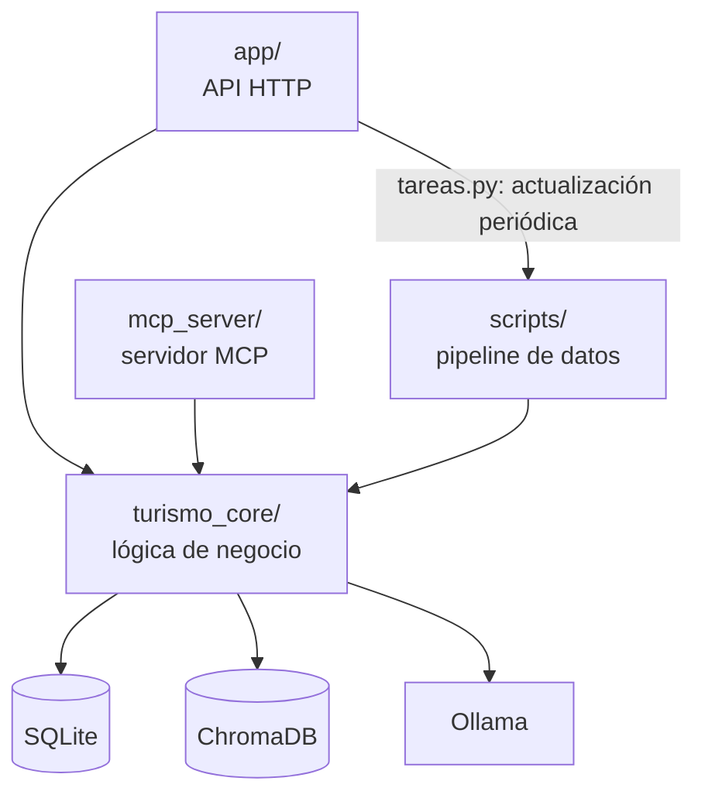

# Backend

## Qué es

El servidor de RUMBO, en **Python ≥ 3.12**. Reúne la API, la lógica de negocio, el servidor MCP, el pipeline de datos y las pruebas. Responsable: Axel.

## Para qué sirve

- Calcula el **semáforo en vivo** de cada lugar a partir de datos oficiales, clima y reportes de turistas.
- Recomienda **otro lugar u otra hora** cuando el lugar pedido no conviene.
- Guarda las sesiones y los reportes de los turistas.
- Responde el **asistente**, que solo usa los datos de la app y cita sus fuentes.
- Da a la Secretaría de Turismo **indicadores agregados** y le permite fijar el color de un lugar.
- Convierte los archivos oficiales en la base de datos que usa todo lo anterior.

## Cómo está construido



**Regla de capas:** `turismo_core` no sabe nada de HTTP ni de MCP. `app/` y `mcp_server/` solo traducen hacia esa capa, por eso responden exactamente lo mismo.

| Tecnología         | Uso                                                                             |
| ------------------ | ------------------------------------------------------------------------------- |
| FastAPI + Uvicorn  | API HTTP. Swagger en `http://localhost:8000/docs`                               |
| SQLite             | Catálogo, datos oficiales, estimaciones y lo que genera la app                  |
| ChromaDB           | Textos que consulta el asistente, en 5 colecciones                              |
| Ollama             | `qwen3:8b` por defecto para redactar y `bge-m3` para embeddings                 |
| `mcp` (FastMCP)    | Servidor MCP; fijado a `<2` porque en la 2.x cambió de nombre                   |
| `pypdf`            | Rellena filas del PDF del Observatorio que la conversión a Markdown perdió      |
| `uv` y `pytest`    | Dependencias y pruebas                                                          |

### Estado actual

- La base es **SQLite** y no hay **login**: el turista usa una sesión anónima y los endpoints `/api/panel/*` están abiertos.
- La migración a Firebase y los roles son trabajo pendiente de Diseño de Software; su avance está en [`docs/DdS/README.md`](../docs/DdS/README.md).
- La regla que la base hace cumplir hoy es el trigger `reporte_uno_cada_30_min`, en `sql/esquema.sql`.

## Qué contiene

```text
backend/
├── pyproject.toml     # proyecto, dependencias y configuración de pytest
├── uv.lock            # versiones exactas de las dependencias
├── app/               # API HTTP
│   ├── main.py        # crea la app, registra routers y sirve el frontend compilado
│   ├── deps.py        # dependencias: conexión a la base, hora y modo demo
│   ├── schemas.py     # contrato con el frontend (modelos Pydantic)
│   ├── tareas.py      # actualizaciones periódicas mientras corre la API
│   └── routers/       # endpoints por tema
├── turismo_core/      # lógica de negocio pura
├── mcp_server/
│   └── server.py      # servidor MCP
├── scripts/           # pipeline de datos y utilidades
├── sql/
│   └── esquema.sql    # tablas, índices y trigger
├── tests/             # 113 pruebas con pytest
└── data/              # datos de entrada, procesados y bases
```

Cada carpeta de Python tiene también su `__init__.py`. El de `scripts/` define las rutas que usa el pipeline; el de `turismo_core/` solo trae su descripción.

### `app/routers/`: endpoints

Todos llevan el prefijo `/api`.

| Archivo      | Método y ruta                         | Qué hace                                                        |
| ------------ | ------------------------------------- | --------------------------------------------------------------- |
| `puntos.py`  | `GET /puntos`                         | Catálogo de lugares                                             |
|              | `GET /semaforo`                       | Estado actual de todos los lugares                              |
|              | `GET /puntos/{punto_id}/estado`       | Detalle y estado de un lugar                                    |
|              | `GET /puntos/{punto_id}/semana`       | Estimación por día y hora de los próximos días                  |
| `turista.py` | `POST /sesiones`                      | Crea la sesión anónima con intereses, horas y punto de partida  |
|              | `POST /recomendar`                    | "Mejor ve a…"                                                   |
|              | `POST /busquedas/{busqueda_id}/aceptar` | Registra si el turista aceptó la recomendación                |
|              | `POST /reportes`                      | "¿Cómo está?": reporte de un turista                            |
| `chat.py`    | `POST /chat`                          | Pregunta al asistente                                           |
| `panel.py`   | `GET /panel/afluencia`                | Afluencia agregada                                              |
|              | `GET /panel/redirecciones`            | A dónde se redirigió a los turistas                             |
|              | `GET /panel/derrama`                  | Derrama estimada                                                |
|              | `GET /panel/semaforo-estatal`         | Destinos del Observatorio contra su propia historia             |
|              | `GET /panel/umbrales`                 | Umbrales del semáforo por lugar                                 |
|              | `GET` y `POST /panel/ajustes`         | Consulta o fija el color de un lugar                            |
|              | `DELETE /panel/ajustes/{ajuste_id}`   | Quita un ajuste                                                 |
| `sistema.py` | `GET /salud`                          | Revisión previa a la demo: claves, Ollama, ChromaDB y datos     |

### `turismo_core/`: lógica de negocio

| Módulo            | Qué hace                                                                                                 |
| ----------------- | -------------------------------------------------------------------------------------------------------- |
| `servicio.py`     | Fachada de lo que ve y hace el turista; la usan la API y MCP                                             |
| `situacion.py`    | Junta, para cada lugar y hora, afluencia, reportes, ajuste manual y lluvia                               |
| `estado.py`       | Determina el estado del semáforo a partir de umbrales, reportes y ajuste manual                          |
| `semaforo.py`     | Umbrales de cada lugar y regla de color: verde, amarillo o rojo                                          |
| `afluencia.py`    | Estimación por hora: `base del mes × f_día × f_hora × f_evento × f_clima`                                |
| `reportes.py`     | Filtra los reportes de turistas y los fusiona con la estimación                                          |
| `conveniencia.py` | Índice de qué tan buena idea es ir ahora: `0.40 afluencia + 0.25 clima + 0.35 traslado`                  |
| `recomendador.py` | Elige alternativas: `0.3 similitud + 0.7 conveniencia`                                                   |
| `traslados.py`    | Matriz de traslados con OpenRouteService                                                                 |
| `trafico.py`      | Factor de tráfico por corredor con TomTom                                                                |
| `clima.py`        | Pronóstico de Open-Meteo y su efecto en la afluencia                                                     |
| `panel.py`        | Vistas agregadas de la Secretaría; nunca reportes individuales                                           |
| `rag.py`          | Asistente: recuperar, sumar el estado en vivo, redactar y citar                                          |
| `conocimiento.py` | Textos que se indexan en ChromaDB, armados con plantillas desde los datos                                |
| `vector.py`       | Conexión a ChromaDB y colecciones `puntos`, `eventos`, `conocimiento`, `bitacora` y `establecimientos`   |
| `llm.py`          | Cliente de Ollama: redacción y embeddings                                                                |
| `ingesta.py`      | Lectura y limpieza de las fuentes oficiales                                                              |
| `bd.py`           | Conexión a SQLite y creación del esquema                                                                 |
| `config.py`       | Lee `backend/.env`; las variables del entorno tienen prioridad                                           |

### `mcp_server/server.py`: servidor MCP

Expone la misma lógica a clientes MCP como Claude Desktop o Claude Code:

```bash
uv run python -m mcp_server.server
```

| Tipo             | Elementos                                                                                                                                                                                       |
| ---------------- | ----------------------------------------------------------------------------------------------------------------------------------------------------------------------------------------------- |
| Tools de turista | `puebla_buscar_punto`, `puebla_que_hago_ahora`, `puebla_estado_punto`, `puebla_semana_punto`, `puebla_recomendar_alternativa`, `puebla_tiempo_traslado`, `puebla_eventos`, `puebla_reportar`    |
| Tools de gobierno | `puebla_afluencia_zona`, `puebla_redirecciones`, `puebla_derrama`, `puebla_semaforo_estatal`, `puebla_historico_destino`                                                                       |
| Tools de asistente | `puebla_buscar_conocimiento`, `puebla_preguntar_asistente`                                                                                                                                    |
| Recursos         | `datos://puntos`, `datos://fuentes`, `datos://modelos`                                                                                                                                          |
| Prompts          | `plan_turista`, `reporte_fin_de_semana`                                                                                                                                                         |

La única tool que escribe en la base es `puebla_reportar`.

### `scripts/`: pipeline de datos

`scripts/pipeline.py` corre estos pasos en orden. Las etiquetas son las que imprime el pipeline; no son consecutivas porque vienen del plan original.

| Etiqueta | Script                    | Entrada → salida                                                             |
| -------- | ------------------------- | ---------------------------------------------------------------------------- |
| 1        | `copiar_datos.py`         | Carpeta de origen → `data/raw/` y `data/manifiesto_raw.csv`                  |
| 2        | `extraer_observatorio.py` | Tabla del Observatorio → `processed/observatorio.csv`                        |
| 3        | `limpiar_inah.py`         | Reportes del INAH → `processed/inah.csv` y `processed/recintos_inah.csv`     |
| 4        | `filtrar_denue.py`        | Zip del DENUE → `processed/denue_zona_piloto.csv` y `municipios_denue.csv`   |
| 7        | `cargar_bd.py`            | Procesados, catálogo, eventos y calendario → SQLite                          |
| 6        | `calcular_traslados.py`   | OpenRouteService → `matriz_traslado`; necesita `ORS_API_KEY` o su caché      |
| 6b       | `actualizar_trafico.py`   | TomTom → `obs_trafico`                                                       |
| 7a       | `actualizar_clima.py`     | Open-Meteo → `obs_clima`                                                     |
| 7b       | `calcular_afluencia.py`   | Historia y pronóstico → `umbral_punto` y `afluencia_estimada`                |
| 8        | `validar_bd.py`           | Revisiones de calidad; si una falla, termina con error                       |
| 9        | `indexar_chroma.py`       | Textos → ChromaDB; sin Ollama se salta con un aviso                          |

Fuera del pipeline, se corren a mano:

| Script                   | Qué hace                                                                                                      |
| ------------------------ | ------------------------------------------------------------------------------------------------------------- |
| `verificar_catalogo.py`  | Busca cada lugar en DENUE y OpenStreetMap, y escribe una propuesta sin modificar el catálogo                  |
| `evaluar_rag.py`         | Evalúa al asistente con 20 preguntas y escribe `processed/evaluacion_rag.md`                                  |
| `probar_recomendador.py` | Casos de prueba del recomendador contra la base real                                                          |

### `sql/esquema.sql`: tablas

| Grupo                | Tablas                                                                                                       |
| -------------------- | ------------------------------------------------------------------------------------------------------------ |
| Catálogos            | `fuente`, `destino`, `punto`, `recinto_inah`, `evento`, `calendario`                                         |
| Hechos oficiales     | `hecho_observatorio`, `hecho_inah`, `establecimiento`, `matriz_traslado`                                     |
| En vivo              | `obs_clima`, `obs_trafico`                                                                                   |
| Generado por la app  | `sesion`, `reporte`, `busqueda`                                                                              |
| Derivados            | `afluencia_estimada`, `umbral_punto`, `ajuste_manual`                                                        |

`cargar_bd.py` se puede repetir: reemplaza catálogos y hechos oficiales, pero conserva sesiones, reportes, búsquedas y ajustes.

### `tests/`: pruebas

| Archivo                  | Qué prueba                                                                |
| ------------------------ | ------------------------------------------------------------------------- |
| `test_api.py`            | Endpoints contra una base sintética                                       |
| `test_mcp.py`            | Tools del servidor MCP, nombres libres y errores                          |
| `test_semaforo.py`       | Umbrales y colores                                                        |
| `test_afluencia.py`      | Estimación de afluencia                                                   |
| `test_reportes.py`       | Filtro y fusión de reportes                                               |
| `test_recomendador.py`   | Conveniencia, similitud y alternativas                                    |
| `test_clima.py`          | Lectura del pronóstico y su efecto                                        |
| `test_trafico.py`        | Factor por corredor, vigencia y efecto en los traslados, sin llamar a TomTom |
| `test_traslados.py`      | Formato de OpenRouteService y lectura de `.env`                           |
| `test_ingesta.py`        | Limpieza de las fuentes oficiales                                         |
| `test_rag.py`            | Partes del asistente que no necesitan Ollama                              |

### `data/`: datos

| Elemento                               | En git | Qué es                                                                                         |
| -------------------------------------- | ------ | ---------------------------------------------------------------------------------------------- |
| `desarrollo.db`                        | Sí     | Base de desarrollo. Se quita del repositorio en el merge a `main` de la versión 1.0            |
| `eventos.csv`                          | Sí     | 11 eventos curados a mano, cada uno con su fuente                                              |
| `equivalencias_inah.csv`               | Sí     | Relaciona recintos del INAH con lugares del catálogo                                           |
| `manifiesto_raw.csv`                   | Sí     | Fecha, tamaño y SHA-256 de cada archivo oficial copiado                                        |
| `processed/observatorio.csv`           | Sí     | Observatorio Turístico en formato largo                                                        |
| `processed/inah.csv`                   | Sí     | Visitas a recintos del INAH                                                                    |
| `processed/recintos_inah.csv`          | Sí     | Los 19 recintos del INAH en Puebla                                                             |
| `processed/denue_zona_piloto.csv`      | Sí     | Establecimientos turísticos del DENUE en la zona piloto                                        |
| `processed/municipios_denue.csv`       | Sí     | Nombre y clave INEGI de los municipios del estado                                              |
| `processed/verificacion_catalogo.csv`  | Sí     | Salida de `verificar_catalogo.py`. Cubre los 20 lugares originales                             |
| `processed/propuesta_catalogo.csv`     | Sí     | Propuesta de coordenadas de los 20 lugares originales. Es histórica: ningún script la lee ni la genera |
| `processed/evaluacion_rag.md`          | Sí     | Resultado de `evaluar_rag.py`                                                                  |
| `raw/`                                 | No     | Archivos oficiales y matrices de OpenRouteService ya consultadas. Se copia a mano              |
| `puebla.db`                            | No     | Base real, generada con el pipeline                                                            |
| `chroma/`                              | No     | Índice del asistente, generado con el pipeline                                                 |

## Cómo se usa

Todo se corre desde `backend/`. La guía completa está en [`INSTALACION.md`](../INSTALACION.md).

```bash
uv sync                                          # instala dependencias
uv run uvicorn app.main:app --reload --port 8000 # levanta la API con puebla.db
uv run pytest -q                                 # corre las pruebas
uv run python -m scripts.pipeline data/raw       # regenera la base real
```

Para desarrollar sin datos reales, usa `desarrollo.db` con las variables de la tabla siguiente, o regenérala con [`herramientas/bd_desarrollo.py`](../herramientas/README.md).

## Configuración

Se define en el entorno o en `backend/.env`, que nunca se sube a git. Excepción: `DATABASE_URL`, `PUEBLA_DEMO`, `PUEBLA_TAREAS` y `CORS_ORIGINS` solo se leen del entorno.

| Variable                       | Uso                                                                  | Valor por defecto                                 |
| ------------------------------ | -------------------------------------------------------------------- | ------------------------------------------------- |
| `DATABASE_URL`                 | Base SQLite que se usa                                               | `sqlite:///data/puebla.db`                        |
| `PUEBLA_TAREAS`                | `0` apaga las actualizaciones periódicas                             | Encendidas                                        |
| `PUEBLA_DEMO`                  | `1` marca las sesiones nuevas como demo                              | `0`                                               |
| `CORS_ORIGINS`                 | Orígenes permitidos, separados por coma                              | `localhost` y `127.0.0.1` en el puerto 5173       |
| `ORS_API_KEY`                  | Clave de OpenRouteService                                            | Sin valor                                         |
| `TOMTOM_API_KEY`               | Clave de TomTom                                                      | Sin valor                                         |
| `TRAFICO_MIN`, `TRAFICO_HORAS` | Frecuencia y horario de las consultas de tráfico                     | `30` y `8-20`                                     |
| `OLLAMA_URL`                   | Servidor de Ollama                                                   | `http://127.0.0.1:11434`                          |
| `OLLAMA_MODELO`                | Modelo que redacta                                                   | `qwen3:8b`                                        |
| `EMBED_MODEL`                  | Modelo de embeddings; si cambia, hay que reindexar ChromaDB          | `bge-m3`                                          |
| `OLLAMA_KEEP_ALIVE`, `OLLAMA_CTX` | Tiempo en memoria y contexto del modelo                           | Definidos en `turismo_core/llm.py`                |
| `CHROMA_HOST`, `CHROMA_PORT`   | Usa un servidor de ChromaDB en lugar de `data/chroma/`               | Sin servidor                                      |

## Actualizaciones mientras corre la API

Con `PUEBLA_TAREAS` encendido, `app/tareas.py` trabaja en hilos aparte:

- **Al arrancar y cada hora, al minuto 5:** clima, afluencia estimada, precarga de modelos y bitácora de reportes en ChromaDB.
- **Cada 30 minutos, de 8:00 a 20:00:** tráfico.

Si falla un servicio externo, la API sigue funcionando: usa el último dato guardado o trabaja sin ese dato.
