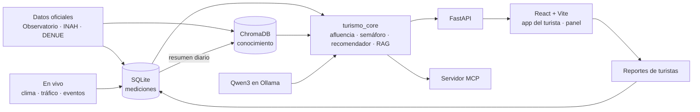

# 🗺️ Hackathon Puebla Turística 360° — Índice

> [!info] Estado (2026-10-15)
> Las notas 00 a 06 están reescritas con la **propuesta v2: "¿A dónde voy ahora?", el turista en tiempo real**. El 2026-10-14 se incorporaron los cambios del asesor, **Rafael Pérez Aguirre**: **RAG con ChromaDB**, **Qwen3** en lugar de Llama, y **FastAPI + React + Vite** en lugar de Streamlit.
> La v2 ya está en el repo (`develop`). El 2026-10-15 se integró la propuesta de Angel: **07, 08 y 09 reescritas a la v2** (dinero nuevo, licencias comerciales, pitch de 5 min) y la nota nueva **10 - Análisis FIS** (actores, casos de uso, reglas y estados).
> También el 2026-10-15: nota **13 - Referencias y benchmarking** (apps parecidas en el mundo) y, a partir de ella, **semáforo con umbrales por lugar**, **ajuste manual** desde el panel, fusión de reportes con los umbrales del punto y tres tools nuevas del MCP ([[05 - Arquitectura y MCP]], RN_01 y RN_16 de [[10 - Análisis FIS]]).
> Lo marcado **(verificar)** se confirma antes de usarlo en el pitch o en el código.

## 👋 La propuesta en 30 segundos

**Problema:** el turismo de Puebla se amontona en pocos lugares. Cd. Puebla recibe el 46.3% de los turistas y se queda con el 68.5% de la derrama, y la Z.A. de Cholula concentra el 36–40% de las visitas a recintos INAH. Mientras tanto, hay destinos a menos de una hora con hoteles medio vacíos. El turista no sabe *en el momento* que un lugar está lleno, que va a llover o que el acceso está atascado.

**Solución:** una app para el **turista** que le dice a dónde ir **ahora**, y un **panel para el gobierno** con los datos que esa app genera.
1. **Semáforo en vivo** de los atractivos de la zona piloto (Puebla–Cholula–Atlixco), según afluencia estimada, clima, tráfico y eventos.
2. **Redirección con explicación:** "Cholula 🔴 ahora no conviene → mejor ve a Atlixco 🟢".
3. **Reportes de turistas** ("¿cómo está?": vacío / normal / lleno), estilo Waze, que corrigen la estimación en tiempo real.
4. **Asistente con IA** (Qwen3 local + **RAG sobre ChromaDB**, también vía MCP) que responde solo con nuestros datos y cita sus fuentes.
5. **Panel de la Secretaría:** mapa de afluencia, redirecciones y derrama redistribuida medida.

**Lo que se le vende al gobierno:** **más derrama y mejor repartida**, menos saturación y **datos que hoy no tiene** (afluencia por hora y a dónde se va el turista cuando cambia de plan).

## 📚 Mapa de contenido

| # | Nota | De qué trata |
|---|---|---|
| 01 | [[01 - Convocatoria y reglas]] | Reto, evaluación en stand del viernes 16, entregables, rúbrica y cómo la atacamos |
| 02 | [[02 - Problema y propuesta]] | Qué quiere comprar el evaluador, la derrama bien explicada, evidencia, usuarios, la app y el panel |
| 03 | [[03 - Ideas y alternativas]] | Componentes de la v2, qué se reutiliza de la v1, qué se cae y qué queda en fase 2 |
| 04 | [[04 - Fuentes de datos]] | Fuentes oficiales, en vivo y de eventos (verificadas en la red), depuración y pipeline |
| 04b | [[04b - Plantilla ficha de fuente de datos]] | Ficha para documentar cada fuente, incluidas las APIs en vivo |
| 05 | [[05 - Arquitectura y MCP]] | Vista general, base relacional (esquema), reportes, afluencia estimada, IA, Qwen3, MCP y stack |
| 05b | [[05b - ChromaDB y RAG]] | Qué es RAG y ChromaDB, colecciones, embeddings, ingesta, consultas, flujo del asistente y evaluación |
| 05c | [[05c - Backend FastAPI y frontend React]] | Endpoints, estructura del backend y del frontend, pantallas, demo con QR por hotspot |
| 06 | [[06 - Plan de trabajo y roles]] | Calendario del martes al viernes, prioridades, roles y checklists |
| 07 | [[07 - Modelo de negocio y escalabilidad]] | Dinero nuevo (sumar, retener, repartir) con escenarios, licencia a gobierno, costos y **licencias comerciales** de cada pieza, normas que aplican, piloto |
| 08 | [[08 - Preguntas abiertas y riesgos]] | Lo resuelto, lo pendiente, **cómo usamos REA** y riesgos de la v2 |
| 09 | [[09 - Guion de pitch]] | Pitch de 5 min con la demo y el dinero, y preguntas del jurado |
| 10 | [[10 - Análisis FIS]] | Actores, casos de uso (ligados a los endpoints), reglas de negocio, estados y requerimientos no funcionales |
| 11 | [[11 - Entregables y estructura]] | Estructura del repo y dónde está la evidencia de cada entregable (§9), criterio de la rúbrica (§11) y categoría especial (§12) |
| 12 | [[12 - Especificación del frontend]] | Pantallas (T1–T6, G1, A1) con su CU, endpoint, componentes y reglas visibles; criterios de UX; maqueta en `frontend/maqueta/` |
| 13 | [[13 - Referencias y benchmarking]] | Apps que ya hacen algo parecido (Barcelona, Ámsterdam, Seúl, Kioto…), algoritmos que adoptamos y servidores MCP de referencia |

## 🗓️ Calendario acordado

| Día | Qué |
|---|---|
| **Mar 13** (noche) | Propuesta v2 escrita en el vault |
| **Mié 14** (día) | Platicarla con Angel, el tutor y mi papá; verificar fuentes y claves ([[06 - Plan de trabajo y roles]]) |
| **Mié 14** (noche) | Con luz verde: base de datos, catálogo y pipeline |
| **Jue 15** | App, panel, asistente; ensayo del pitch |
| **Vie 16** | Presentar en el stand, de 12:00 a 15:00 |

## ✅ Decisiones tomadas

| Tema | Decisión |
|---|---|
| Costo | **$0**: nada de APIs de pago ni tarjetas |
| Enfoque | **Turista en tiempo real** + panel de gobierno (v2) |
| Alcance en vivo | **Zona piloto** Puebla–Cholula–Atlixco (15–25 puntos); el resto del estado, con datos mensuales |
| Afluencia "en vivo" | Estimada con datos oficiales + corregida con **reportes de turistas** (no hay fuente pública en vivo) |
| Base de datos | **SQLite** (mediciones) + **ChromaDB** (conocimiento para el RAG), las dos locales (2026-10-14, asesor) |
| LLM | Ollama con **`qwen3:4b`** en la laptop y **`qwen3:8b`** en la PC. Kimi K3 se descartó por ser de pago (2026-10-14) |
| Embeddings | `bge-m3` en Ollama (multilingüe) |
| MCP | **FastMCP** del SDK oficial de Python (se conserva) |
| Interfaz | **FastAPI** (backend) + **React + Vite** (frontend), en lugar de Streamlit (2026-10-14, asesor) |
| Demo con QR | La laptop sirve la app por el hotspot del equipo; sin nube ni costo |
| Dinero | Se presenta como **dinero nuevo** (sumar una parada o una noche, retener al que se iría), no solo redistribuido; licencias comerciales a la vista ([[07 - Modelo de negocio y escalabilidad]]) |
| Equipo y roles | Axel: todo lo que no es frontend (datos, backend, RAG, IA y MCP). Angel: frontend y venta (negocio y pitch). Diego Navarro Sánchez completa el equipo. Tutor: Mtro. Rafael Pérez Aguirre |
| Git | `develop` guarda la propuesta; el código va en las branches `backend` (Axel) y `frontend` (Angel), que se integran a `develop` ([[06 - Plan de trabajo y roles]]) |

## ❓ Decisiones pendientes

- [x] ¿El tutor aprueba la v2? Sí, con tres cambios (RAG con ChromaDB, otro modelo, FastAPI + React) — 2026-10-14
- [ ] **Nombre**: ideas como "Puebla Ahora", "¿Y si mejor…?" o "Ruta Viva".
- [x] **Roles**, **tercer integrante** y **tutor**: ver la tabla de decisiones y [[06 - Plan de trabajo y roles]] (2026-10-15).
- [x] Actualizar 07, 08 y 09 a la v2 (2026-10-15).

## 📖 Glosario rápido

| Término | Qué es |
|---|---|
| **Derrama económica** | Lo que **gastan** los turistas en un destino. Es **ingreso**: se quiere que **suba** y que **se reparta** |
| **Afluencia estimada** (*nowcast*) | Cuánta gente calculamos que hay ahora en un lugar, a partir del promedio oficial del mes y factores de día, hora, clima y eventos |
| **Reporte** | El botón "¿cómo está?" que presiona el turista al llegar |
| **Índice de conveniencia** | Puntaje que decide el color del semáforo de cada punto |
| **MCP** | Protocolo para que un asistente de IA use nuestras herramientas (*tools*), datos (*resources*) y plantillas (*prompts*) |
| **FastMCP** | La forma de escribir un servidor MCP en el SDK oficial de Python |
| **Ollama** | Programa para correr modelos de IA abiertos en la computadora, sin internet ni pago |
| **Qwen3** | El modelo de lenguaje abierto que corre dentro de Ollama (4B en la laptop, 8B en la PC) |
| **RAG** | Buscar en nuestra base los textos relevantes y dárselos al modelo para que responda solo con eso, citando fuentes |
| **ChromaDB** | Base de datos vectorial: guarda textos con su *embedding* y busca por significado |
| **Embedding** | Lista de números que representa el significado de un texto; textos parecidos quedan cerca |
| **FastAPI** | Framework de Python para hacer la API (backend) |
| **React + Vite** | Librería para la interfaz (frontend) y la herramienta que la crea y sirve en desarrollo |
| **Tool calling** | Cuando el modelo decide qué herramienta llamar y con qué datos |
| **Holt-Winters** | Pronóstico de series de tiempo con estacionalidad (lo usamos para la afluencia "normal" del mes) |
| **Similitud coseno** | Cómo medimos qué tan parecidos son dos lugares para recomendar alternativas |

## 🔗 Relacionado
- [[indice-proyectos]]
- [[mcp-course]] — proyecto personal de aprendizaje de MCP en este vault

---
#hackathon #proyecto
