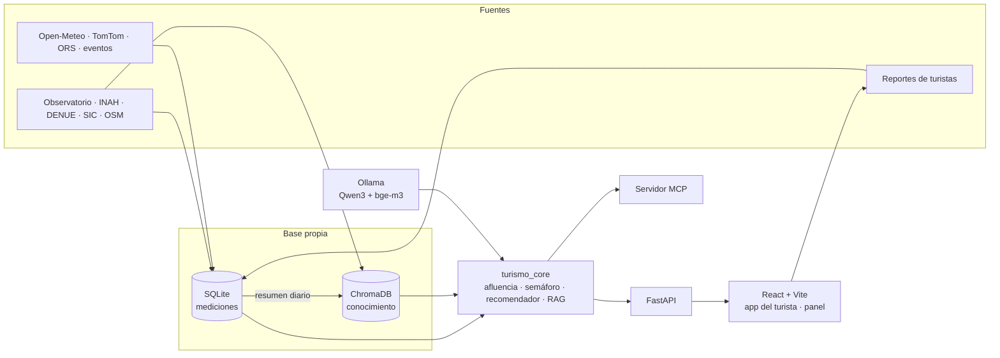
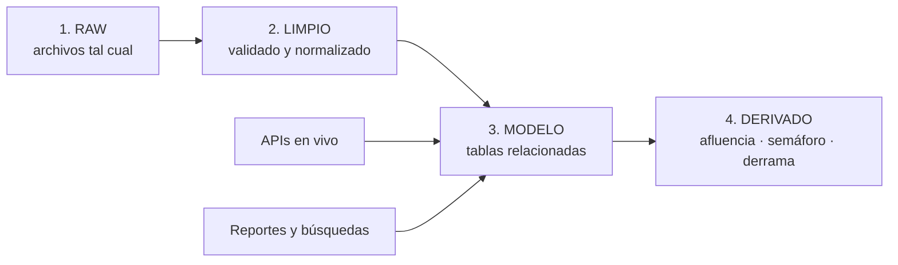
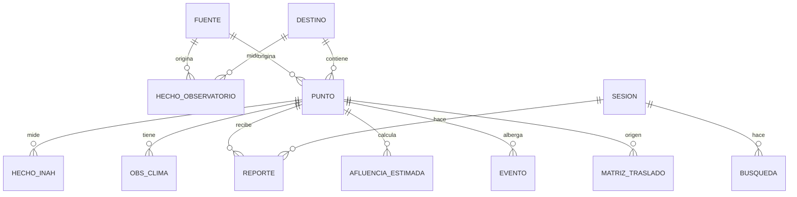

# 🏗️ Arquitectura y MCP

> [!success] Cambios del asesor (2026-10-14)
> **Rafael Pérez Aguirre** recomendó tres cambios, y ya están aplicados en esta nota:
> 1. **Base de conocimiento propia con RAG sobre ChromaDB** → detalle en [[05b - ChromaDB y RAG]].
> 2. **Otro modelo en lugar de Llama.** Mencionó Kimi K3, pero es de pago (ver la sección "Modelo de lenguaje"). Se decidió **Qwen3 en Ollama**, que es gratis y local.
> 3. **FastAPI de backend y React + Vite de frontend**, en lugar de Streamlit → detalle en [[05c - Backend FastAPI y frontend React]].
>
> El servidor MCP **se conserva**.

## 🧱 Vista general



| Capa | Función |
|---|---|
| 1. Ingesta | Archivos oficiales a `data/raw/`; consultas a las APIs en vivo ([[04 - Fuentes de datos]]) |
| 2. Limpieza | Scripts de depuración por fuente; filtros antispam para los reportes |
| 3. Base de datos | **SQLite** (`puebla.db`) para números y tiempo + **ChromaDB** (`data/chroma/`) para textos y búsqueda por significado ([[05b - ChromaDB y RAG]]) |
| 4. Modelos (IA) | Afluencia estimada, fusión con reportes, índice de conveniencia, recomendador semántico, pronóstico, RAG |
| 5. Servicios | `turismo_core`: **una sola fuente de verdad** para FastAPI, el MCP y el asistente |
| 6. Interfaces | **FastAPI** (API REST) + **React + Vite** (app del turista y panel de gobierno) + servidor MCP (FastMCP) ([[05c - Backend FastAPI y frontend React]]) |

## 🗄️ Base de datos

### Cuatro capas



| Capa | Qué guarda | Regla |
|---|---|---|
| **1. Raw** | El PDF, los `.xls`, el zip y las respuestas de las APIs | **Nunca se edita.** Se guarda con fecha de descarga y *hash* (huella) para saber de qué versión salió cada número |
| **2. Limpio** | Las mismas tablas, corregidas | Toda corrección se hace con un script, nunca a mano en Excel. Si se vuelve a correr, sale igual |
| **3. Modelo** | Tablas relacionadas | Llaves únicas, sin duplicados, cada fila con su `fuente_id` |
| **4. Derivado** | Afluencia estimada, semáforo y derrama redistribuida | Se recalcula; nunca se escribe a mano |

### Motores: costo cero, todo en la laptop

| Motor | Qué guarda | Por qué |
|---|---|---|
| **SQLite** (`puebla.db`) | Catálogos, hechos oficiales, clima, tráfico, reportes, búsquedas, afluencia estimada | Viene con Python, no se instala nada y funciona sin internet. Sirve para contar, sumar y filtrar por tiempo |
| **ChromaDB** (`data/chroma/`) | Fichas de los puntos, eventos, boletines, glosario, fichas de fuentes y resúmenes diarios de reportes | Busca por **significado** para el RAG y el recomendador ([[05b - ChromaDB y RAG]]) |

> [!tip] Ya no hace falta Supabase
> Como la demo con QR se sirve desde la laptop por el hotspot ([[05c - Backend FastAPI y frontend React]]), los reportes se guardan en la SQLite local y no se pierden. Si algún día se publica en la nube, el esquema se escribe compatible con PostgreSQL y basta con cambiar `DATABASE_URL`.

### Esquema



#### Catálogos (cambian poco)

```sql
-- De dónde sale cada dato (trazabilidad)
CREATE TABLE fuente (
    id              INTEGER PRIMARY KEY,
    nombre          TEXT NOT NULL,          -- 'Observatorio Turístico', 'Open-Meteo'...
    url             TEXT,
    licencia        TEXT,                   -- 'CC BY 4.0', 'Datos abiertos SIC'...
    frecuencia      TEXT,                   -- 'mensual', 'horaria', 'única'
    fecha_descarga  TEXT,                   -- YYYY-MM-DD
    hash_archivo    TEXT                    -- huella del archivo raw
);

-- Los 20 centros turísticos del Observatorio
CREATE TABLE destino (
    id          INTEGER PRIMARY KEY,
    nombre      TEXT NOT NULL UNIQUE,       -- 'Atlixco', 'San Pedro Cholula'...
    cve_mun     TEXT,                       -- clave INEGI del municipio
    lat REAL, lon REAL,
    es_piloto   INTEGER DEFAULT 0           -- 1 si está en la zona piloto
);

-- Atractivos de la zona piloto (15–25)
CREATE TABLE punto (
    id            INTEGER PRIMARY KEY,
    nombre        TEXT NOT NULL,
    destino_id    INTEGER REFERENCES destino(id),
    tipo          TEXT,                     -- 'zona_arqueologica', 'museo', 'plaza', 'mercado'...
    categorias    TEXT,                     -- 'historia,gastronomia' (para el recomendador)
    interior      INTEGER,                  -- 1 = techado (sirve si llueve)
    lat REAL NOT NULL, lon REAL NOT NULL,
    horario       TEXT,                     -- JSON: {"mar":"09:00-18:00", ...}
    costo_mxn     REAL,
    id_inah       TEXT,                     -- para unir con hecho_inah
    clee_denue    TEXT,                     -- id del DENUE
    osm_id        TEXT,
    fuente_id     INTEGER REFERENCES fuente(id),
    verificado    INTEGER DEFAULT 0         -- 1 = revisado a mano por el equipo
);

CREATE TABLE evento (
    id          INTEGER PRIMARY KEY,
    nombre      TEXT NOT NULL,
    punto_id    INTEGER REFERENCES punto(id),     -- o NULL si es de todo el destino
    destino_id  INTEGER REFERENCES destino(id),
    inicio      TEXT NOT NULL, fin TEXT NOT NULL,  -- YYYY-MM-DD HH:MM
    impacto     TEXT CHECK (impacto IN ('bajo','medio','alto')),
    fuente_url  TEXT NOT NULL,                     -- sin fuente, no entra
    verificado  INTEGER DEFAULT 0
);

CREATE TABLE calendario (
    fecha       TEXT PRIMARY KEY,           -- YYYY-MM-DD
    dia_semana  INTEGER,                    -- 0 = lunes
    es_festivo  INTEGER, es_puente INTEGER, es_vacaciones INTEGER
);
```

#### Hechos oficiales (históricos)

```sql
-- Formato "largo": una fila por destino, mes e indicador
CREATE TABLE hecho_observatorio (
    destino_id  INTEGER REFERENCES destino(id),
    periodo     TEXT,                       -- 'YYYY-MM'
    indicador   TEXT,                       -- 'ocupacion_pct', 'llegadas', 'derrama_mxn'...
    valor       REAL,
    es_pandemia INTEGER DEFAULT 0,          -- 2020–2021 marcados
    fuente_id   INTEGER REFERENCES fuente(id),
    PRIMARY KEY (destino_id, periodo, indicador)
);

CREATE TABLE hecho_inah (
    punto_id        INTEGER REFERENCES punto(id),
    periodo         TEXT,                   -- 'YYYY-MM'
    tipo_visitante  TEXT,                   -- según columnas del reporte
    nacionalidad    TEXT,                   -- 'nacional' / 'extranjero'
    visitas         INTEGER,
    fuente_id       INTEGER REFERENCES fuente(id),
    PRIMARY KEY (punto_id, periodo, tipo_visitante, nacionalidad)
);

-- Traslados base (se calcula una vez con OpenRouteService)
CREATE TABLE matriz_traslado (
    origen_id    INTEGER REFERENCES punto(id),
    destino_id   INTEGER REFERENCES punto(id),
    minutos_base REAL, km REAL,
    fuente_id    INTEGER REFERENCES fuente(id),
    PRIMARY KEY (origen_id, destino_id)
);
```

#### Datos en vivo (se guardan, no se tiran)

```sql
CREATE TABLE obs_clima (
    punto_id      INTEGER REFERENCES punto(id),
    consultado_en TEXT,                     -- cuándo preguntamos
    valido_para   TEXT,                     -- hora pronosticada
    temp_c REAL, prob_lluvia_pct REAL, lluvia_mm REAL, weather_code INTEGER,
    PRIMARY KEY (punto_id, consultado_en, valido_para)
);

CREATE TABLE obs_trafico (
    tramo         TEXT,                     -- 'acceso_cholula'...
    consultado_en TEXT,
    vel_actual REAL, vel_libre REAL,
    factor        REAL,                     -- vel_libre / vel_actual (1.0 = libre)
    PRIMARY KEY (tramo, consultado_en)
);
```

> [!note] ¿Por qué guardar el clima y el tráfico, y no solo mostrarlos?
> En unas semanas da **historia propia** para responder preguntas como "¿cuánto baja la afluencia en Cholula cuando llueve?" o "¿a qué hora se satura el acceso a Atlixco los sábados?". Con eso se **calibra** el modelo con datos reales en lugar de supuestos.

#### Datos que genera la app (lo más valioso)

```sql
-- Sesión anónima: no se piden nombre, correo ni teléfono
CREATE TABLE sesion (
    id          TEXT PRIMARY KEY,           -- UUID aleatorio generado en el navegador
    creada_en   TEXT,
    perfil      TEXT,                       -- 'historia,gastronomia' (lo que eligió)
    es_demo     INTEGER DEFAULT 0           -- 1 = evaluadores en el stand
);

CREATE TABLE reporte (
    id            INTEGER PRIMARY KEY,
    sesion_id     TEXT REFERENCES sesion(id),
    punto_id      INTEGER REFERENCES punto(id),
    creado_en     TEXT NOT NULL,
    nivel         INTEGER CHECK (nivel IN (1,2,3)),  -- 1 vacío, 2 normal, 3 lleno
    espera_min    INTEGER,                  -- opcional: "¿cuánto esperaste?"
    distancia_m   REAL,                     -- distancia del celular al punto (si dio GPS)
    peso          REAL,                     -- confianza calculada (0 a 1)
    estado        TEXT DEFAULT 'valido',    -- 'valido' / 'dudoso' / 'descartado'
    motivo        TEXT                      -- por qué se descartó
);

-- Cada recomendación que hace la app y si el turista la aceptó
CREATE TABLE busqueda (
    id             INTEGER PRIMARY KEY,
    sesion_id      TEXT REFERENCES sesion(id),
    creada_en      TEXT,
    punto_pedido   INTEGER REFERENCES punto(id),   -- a dónde quería ir
    punto_sugerido INTEGER REFERENCES punto(id),   -- a dónde lo mandamos
    motivo         TEXT,                           -- 'afluencia', 'lluvia', 'trafico'
    aceptada       INTEGER                         -- 1 si eligió la alternativa
);
```

#### Derivados (los calcula el sistema)

```sql
CREATE TABLE afluencia_estimada (
    punto_id     INTEGER REFERENCES punto(id),
    para_hora    TEXT,                      -- 'YYYY-MM-DD HH:00'
    base         REAL,                      -- de INAH / Observatorio
    f_dia_hora   REAL, f_evento REAL, f_clima REAL,
    estimacion   REAL,                      -- base × factores
    n_reportes   INTEGER,
    valor_final  REAL,                      -- estimación corregida con reportes
    semaforo     TEXT,                      -- 'verde', 'amarillo', 'rojo', 'sin_dato'
    confianza    TEXT,                      -- 'estimado' / 'confirmado por turistas'
    PRIMARY KEY (punto_id, para_hora)
);

-- Umbrales del semáforo de cada punto (se recalculan con el pipeline)
CREATE TABLE umbral_punto (
    punto_id     INTEGER PRIMARY KEY REFERENCES punto(id),
    bajo         REAL NOT NULL,             -- debajo: verde
    alto         REAL NOT NULL,             -- encima: rojo
    metodo       TEXT CHECK (metodo IN ('percentil','general','manual')),
    n_muestras   INTEGER,                   -- meses de historia usados
    calculado_en TEXT
);

-- Color fijado a mano desde el panel (cierre, obra, fila larga); caduca solo
CREATE TABLE ajuste_manual (
    id           INTEGER PRIMARY KEY,
    punto_id     INTEGER REFERENCES punto(id),
    color        TEXT CHECK (color IN ('verde','amarillo','rojo')),
    motivo       TEXT NOT NULL,
    creado_en    TEXT NOT NULL,
    hasta        TEXT NOT NULL
);
```

### Cómo se actualiza la capa en vivo

| Dato | Cada cuánto | Cómo | Consultas/día |
|---|---|---|---|
| Clima | 60 min | Una consulta a Open-Meteo con las 25 coordenadas | ~24 |
| Tráfico | 15–30 min, de 8:00 a 20:00 | TomTom en ~10 tramos | ~240–480 (límite 2,500) |
| Traslados base | Una vez | Una matriz de OpenRouteService | 1 |
| Afluencia estimada | Cuando entra un reporte o cambia el clima | Función de Python | — |

En el prototipo **no hace falta un servidor programado** (*cron*). El backend pide el dato cuando alguien lo necesita y lo guarda en una caché con tiempo de vida dentro de `turismo_core`: 60 min para el clima y 15 para el tráfico ([[05c - Backend FastAPI y frontend React]]). Cada respuesta **se inserta** en `obs_clima` u `obs_trafico`. Si la API falla, se usa la última fila guardada y la app avisa que el dato es de hace X minutos. **En el stand nunca se queda en blanco.**

## 📣 Reportes de turistas: cómo hacen crecer y mejorar la base

Cada vez que alguien presiona **"¿Cómo está?"**, pasa lo siguiente.

### 1. Filtros antes de aceptar un reporte (antispam)

| Regla | Qué detecta | Acción |
|---|---|---|
| **Geocerca**: el celular está a < 500 m del punto (si dio permiso de GPS) | Alguien reportando desde su casa | Sin GPS: `peso` a la mitad. A más de 500 m: `dudoso` |
| **Un reporte por sesión y punto cada 30 min** | Presionar el botón 20 veces | Los repetidos se `descartan` |
| **Velocidad imposible**: dos reportes de la misma sesión en puntos a 20 km con 5 min de diferencia | Bots o bromas | Se descarta la sesión completa |
| **Fuera de horario**: el punto está cerrado | Error o broma | `descartado` |
| **Contradice a la mayoría**: "vacío" cuando los últimos 5 dicen "lleno" | Error o caso raro | Se le baja el `peso`, pero no se borra (puede ser el primero en ver que ya se vació) |
| Sesión con `es_demo` | Evaluadores en el stand | Se guarda, pero se separa de las estadísticas reales |

### 2. Cómo se combinan con la estimación

La afluencia final es un **promedio ponderado** entre el modelo y los turistas:

$$
\text{afluencia} = \frac{w_m \cdot \text{estimación} + \sum_i w_i \cdot r_i}{w_m + \sum_i w_i},
\qquad w_i = \text{peso}_i \cdot e^{-\Delta t_i / 45\,\text{min}}
$$

- $r_i$ es el nivel reportado (1, 2 o 3) y $\Delta t_i$, el tiempo que pasó desde el reporte.
- Un reporte de hace 45 min vale ~37% de uno recién hecho; después de 3 h ya casi no cuenta.
- $w_m$ es el peso fijo del modelo y equivale a unos **2 reportes**: con 1 reporte manda el modelo; con 5 recientes, mandan los turistas.
- Con 3 o más reportes válidos en la última hora, la app muestra **"confirmado por turistas"**. Si no, muestra **"estimado"**.

### 3. Cómo aprende el sistema con el tiempo

| Con… | Se puede… |
|---|---|
| Días de reportes | Reemplazar los perfiles de día y hora (que al inicio son **supuestos** nuestros) por los **reales** de cada punto |
| Reportes + `obs_clima` | Medir cuánto baja de verdad la afluencia cuando llueve, punto por punto |
| `busqueda.aceptada` | Saber qué alternativas acepta la gente y mejorar el recomendador |
| `busqueda` × gasto por visitante (Observatorio) | Calcular la **derrama redistribuida medida**, no solo teórica |

> [!important] El argumento para el pitch
> "El primer día, la app usa datos oficiales y supuestos documentados. Cada reporte la corrige. **Después de un mes, la Secretaría tiene un mapa de afluencia por hora que hoy no existe en ningún lado.**"

### 4. Privacidad
- No se piden nombre, correo ni teléfono. La sesión es un identificador aleatorio.
- La ubicación del celular **no se guarda**: solo la distancia al punto (`distancia_m`).
- Al gobierno solo se le entregan **agregados** por punto y hora, nunca reportes individuales.
- Aviso de privacidad corto en la app, conforme a la ley mexicana de protección de datos personales (**verificar** qué pide para datos anónimos).
- Con Ollama, las preguntas al asistente **no salen de la computadora**. Si se usa el respaldo en la nube (Gemini o Groq), solo viajan la pregunta y datos agregados.

## 🤖 Dónde está la IA (y qué hace cada pieza)

### Capa 1 — Modelos propios (el corazón)

| Modelo | Técnica | Entradas | Salida | Cómo se evalúa | Límites |
|---|---|---|---|---|---|
| **Afluencia estimada** (*nowcast*) | Base oficial × factores de día, hora, evento y clima | INAH (por punto), Observatorio (por destino), calendario, eventos, clima | Nivel relativo de afluencia por punto y hora | Comparar contra los reportes conforme lleguen | Los factores de día y hora **empiezan siendo supuestos**: las fuentes oficiales son mensuales |
| **Fusión con reportes** | Promedio ponderado con caducidad exponencial | Estimación + reportes filtrados | Afluencia final + nivel de confianza | Que no cambie bruscamente con un solo reporte | Depende de cuántos turistas usen la app |
| **Índice de conveniencia** | Puntaje ponderado | Afluencia, clima (si el punto es techado o al aire libre), traslado con tráfico, eventos, horario | Semáforo 🟢🟡🔴 por punto | Revisión de casos ("¿tiene sentido el color?") | Los pesos los definimos nosotros y se documentan |
| **Recomendador semántico** | Similitud coseno entre **embeddings** de las fichas de los puntos (ChromaDB), combinada con conveniencia y cercanía ([[05b - ChromaDB y RAG]]) | Ficha de texto de cada punto, estado en vivo, traslado | La alternativa "parecida pero mejor ahora", con su razón | Revisión cualitativa; con el tiempo, tasa de `aceptada` | Depende de la calidad de las fichas y del modelo de embeddings |
| **Plan del día** (si da tiempo) | Heurística *greedy*: la mejor siguiente parada | Conveniencia + matriz de traslados + tiempo disponible | Recorrido de 2 a 4 paradas | Que respete horarios y tiempo total | No es óptimo global, pero es rápido |
| **Pronóstico estructural** | Holt-Winters con estacionalidad de 12 meses, por destino | Ocupación y afluencia mensual 2017–2026 (sin 2020–2021) | Afluencia "normal" de los próximos meses + semáforo estatal | Últimos 12 meses reservados; MAPE contra "igual que el año pasado" | No ve choques externos |

#### Cómo se calcula la afluencia estimada (antes de los reportes)
1. **Base mensual:**
   - En puntos INAH: visitas del mismo mes en 2023–2025 ÷ días del mes.
   - En puntos sin datos propios: llegadas del destino (Observatorio) repartidas por tipo de punto, con `confianza` más baja.
2. **Escala relativa:** como no conocemos la capacidad de cada lugar, cada punto se compara contra **su propia historia**: base ÷ mediana histórica del punto. Así, 1.0 = un día normal para ese lugar.
3. **Factores** (supuestos documentados, que luego se calibran con reportes):
   - Día y hora: más alto en fin de semana y a mediodía.
   - Puente o festivo: más alto.
   - Evento de impacto alto cerca: más alto.
   - Lluvia: en un punto al aire libre baja la afluencia, pero también su conveniencia.
4. **Semáforo con umbrales por lugar** (`turismo_core/semaforo.py`, idea de Druktebeeld en Ámsterdam, ver [[13 - Referencias y benchmarking]]):
   - Cada punto tiene un umbral `bajo` y uno `alto`, sacados de **su propia historia** relativa: percentil 60 y 85 de sus meses (INAH u Observatorio). Valor < `bajo` 🟢 · entre ambos 🟡 · > `alto` 🔴.
   - Así un punto estacional (Cholula) no vive en rojo cada temporada alta, y un punto estable se pone en rojo en cuanto sale de lo normal.
   - Se acotan (`bajo` 0.8–1.1, `alto` 1.15–1.8, separados al menos 0.15) para que una historia rara no dé cortes absurdos.
   - Con menos de 12 meses de historia se usan los cortes generales: < 0.9 🟢 · 0.9–1.3 🟡 · > 1.3 🔴.
   - La Secretaría puede fijar los umbrales a mano (`metodo = 'manual'`) o fijar el color de un punto por un tiempo (`ajuste_manual`, idea de East Lothian). Lo manual siempre gana y se muestra con su motivo.
   - Sin estimación, el punto queda en `sin_dato` (gris), nunca en verde por omisión.

> [!warning] Ser honestos en el stand
> Los factores de día y hora son **supuestos iniciales**, porque las fuentes oficiales son mensuales. Se dice tal cual, y se muestra que **los reportes son justo lo que los corrige**. Es más defendible que fingir que tenemos afluencia en vivo.

### Capa 2 — IA generativa como interfaz (el asistente con RAG)

Un **asistente en lenguaje natural**, dentro de la app y del panel (y disponible vía MCP en cualquier cliente), que:
1. Recibe una pregunta. Del turista: *"Estoy en el zócalo, tengo 4 horas y llueve, ¿qué hago?"*. Del funcionario: *"¿A dónde se fueron los turistas que no entraron a Cholula este fin?"*.
2. **Recupera** de ChromaDB los textos relevantes (puntos, eventos, boletines, bitácora de reportes) y **calcula** el estado en vivo de esos puntos desde SQLite.
3. Le da todo eso a **Qwen3**, que responde **solo con ese contexto** y cita la fuente de cada dato.

El flujo completo, la plantilla del prompt y cómo se evalúa están en [[05b - ChromaDB y RAG]].

> [!important] Por qué esto no es "un chatbot genérico"
> - El LLM **no sabe nada de Puebla por sí mismo**: toda cifra viene de nuestra base y nuestros modelos.
> - En pantalla se ven **las fuentes y la tabla en vivo** que recibió el modelo, como evidencia de trazabilidad para el jurado.
> - Si el dato no está en el contexto, el asistente dice "No tengo ese dato" (instrucción de sistema + prueba de fidelidad antes de la demo).

## 💸 Principio de costo cero

> [!success] Decisión (2026-10-13)
> **El proyecto no gasta dinero en ninguna pieza.** Nada de APIs de pago ni tarjetas de crédito. Todo es software libre o servicios gratuitos, y si un servicio externo falla, se cambia por otro sin tocar el código.

| Pieza | Cómo se resuelve | Costo |
|---|---|---|
| Datos oficiales | Observatorio, INAH, DENUE, SIC | $0 |
| Datos en vivo | Open-Meteo (sin clave), TomTom y OpenRouteService (claves gratuitas sin tarjeta) | $0 |
| Base de datos | SQLite (mediciones) + ChromaDB (conocimiento, Apache 2.0) | $0 |
| Embeddings | `bge-m3` en Ollama, local | $0 |
| Modelos | `statsmodels`, `scikit-learn`, Python | $0 |
| Backend | FastAPI + Uvicorn | $0 |
| Frontend | React + Vite + Leaflet (mosaicos de OpenStreetMap) | $0 |
| Demo con QR | La laptop sirve la app por el hotspot; sin nube | $0 |
| Servidor MCP | FastMCP (SDK oficial, código abierto) | $0 |
| Asistente | **Qwen3 en Ollama**, local | $0 |
| Respaldo del asistente | Capa gratuita de Gemini o Groq (sin tarjeta) | $0 |

## 🧠 Modelo de lenguaje: Qwen3 en Ollama

> [!question] ¿Qwen3 u Ollama?
> No es una cosa u otra. **Ollama es el programa** que corre modelos en la computadora, y **Qwen3 es el modelo**. Seguimos con Ollama; solo cambiamos el modelo que corre adentro: antes Llama 3.2, ahora Qwen3.

### Por qué no Kimi K3

El asesor mencionó **Kimi K3** (Moonshot AI, julio 2026) como opción si se quería pagar. Se descartó:

| | Kimi K3 | Qwen3 |
|---|---|---|
| Tamaño | ~2.8 billones de parámetros (MoE) | 4B (laptop) / 8B (PC) |
| ¿Corre en nuestra laptop o PC? | ❌ Imposible | ✅ Sí |
| Costo | API de pago: ~US$3 por millón de tokens de entrada y ~US$15 de salida (OpenRouter / Ollama Cloud / Moonshot); no hay vía gratuita confiable | **$0** |
| Internet | Obligatorio | No hace falta |
| Veredicto | Rompe la regla de costo cero | ✅ **Elegido** |

> [!tip] En el pitch
> "Diseñamos el asistente para que el modelo sea intercambiable. Hoy corre Qwen3 gratis en la laptop; si la Secretaría quisiera un modelo más grande como Kimi K3, se cambia una línea de configuración."

### Qué versión en cada máquina

| Máquina | Modelo | Tamaño (Ollama, Q4) | Contexto | Nota |
|---|---|---|---|---|
| **Laptop del stand** (RTX 3050 Ti, 4 GB) | **`qwen3:4b`** | ~2.5 GB | 256K | Cabe en la GPU junto con el embedding de la pregunta |
| **PC de desarrollo** (RTX 3070, 8 GB) | **`qwen3:8b`** | ~5.2 GB | 40K | Más preciso para iterar. **Todo se prueba también con el 4B**, porque en el stand corre el chico |
| Alternativa a probar | `qwen3.5:4b` | ~3.4 GB | — | Más nuevo, pero más justo para 4 GB junto con `bge-m3`. Probar en la PC antes de decidir |

> [!warning] Modo de razonamiento ("thinking")
> Qwen3 puede "pensar en voz alta" antes de responder. Eso lo hace más lento. Para el asistente conviene **apagarlo**: en la API nativa de Ollama se manda `"think": false`, y Qwen3 también acepta `/no_think` dentro del mensaje. **Verificar cuál funciona por el endpoint compatible con OpenAI** antes de elegir el cliente.

### Cómo se conecta sin atarse a un proveedor

Ollama, Gemini y Groq ofrecen una **API compatible con el formato de OpenAI**. El asistente se escribe **una sola vez** con el cliente `openai` de Python (`turismo_core/llm.py`), y el proveedor se elige en `.env`:

```bash
# Modelo de lenguaje: local, sin internet, código abierto
LLM_BASE_URL=http://localhost:11434/v1
LLM_MODEL=qwen3:4b         # laptop del stand
# LLM_MODEL=qwen3:8b       # PC de desarrollo
LLM_API_KEY=ollama         # Ollama no la valida, pero el cliente pide una

# Respaldo gratuito en la nube (solo si hace falta)
# LLM_BASE_URL=https://generativelanguage.googleapis.com/v1beta/openai/
# LLM_BASE_URL=https://api.groq.com/openai/v1

# Embeddings y ChromaDB
OLLAMA_URL=http://localhost:11434
EMBED_MODEL=bge-m3
CHROMA_HOST=               # vacío = PersistentClient; "localhost" = servidor (demo)
CHROMA_PORT=8001

# Base de datos relacional
DATABASE_URL=sqlite:///data/puebla.db

# Claves gratuitas de las APIs en vivo (nunca en el código)
TOMTOM_API_KEY=
ORS_API_KEY=
```

### Opciones, ordenadas por preferencia

| # | Opción | Uso |
|---|---|---|
| 1 | **Ollama + `qwen3:4b`** ✅ | **Stand (laptop)** |
| 2 | **Ollama + `qwen3:8b`** ✅ | **Desarrollo (PC)** |
| 3 | Gemini o Groq, capa gratuita (verificar qué modelos ofrecen hoy) | Respaldo si la laptop no da el ancho; necesita internet |
| 4 | **Sin LLM** | Último recurso: la app y el panel funcionan completos sin asistente |

> [!tip] Hardware disponible
> - **PC de escritorio** (desarrollo): RTX 3070 con 8 GB de VRAM y 16 GB de RAM.
> - **Laptop del stand**: i7-12700H, **RTX 3050 Ti Mobile (4 GB de VRAM)** y 16 GB de RAM.
>
> Para la demo: laptop **conectada a la corriente** y modelo **precargado** (una pregunta de calentamiento antes de que llegue el evaluador).

## 🔌 Servidor MCP

Se **conserva**. Se expone con **FastMCP** del SDK oficial de Python (`from mcp.server.fastmcp import FastMCP`), el mismo del curso de Anthropic. No hay que confundirlo con el paquete aparte `fastmcp` (v2). Con FastMCP, cada tool es una función de `turismo_core` con un decorador encima, y el JSON Schema se genera solo a partir de los *type hints*.

> [!note] FastAPI y MCP conviven
> Son **dos puertas a la misma lógica**: FastAPI atiende a la página web (React) y el servidor MCP atiende a cualquier cliente MCP (el MCP Inspector en la demo, o Claude Desktop). Como los dos importan `turismo_core`, siempre dan las mismas respuestas. En la demo, ChromaDB corre como servidor local para que ambos procesos lo compartan ([[05b - ChromaDB y RAG]]).

### Tools

| Herramienta | Parámetros | Devuelve | Para quién |
|---|---|---|---|
| `que_hago_ahora` | `lat`, `lon`, `intereses`, `horas_disponibles` | Puntos ordenados por conveniencia, con su razón | Turista |
| `buscar_punto` | `texto` | El punto oficial que corresponde a un nombre libre ("la pirámide", "el zócalo de Atlixco"), vía ChromaDB | Ambos |
| `estado_punto` | `punto` | Semáforo, afluencia (estimada o confirmada), **umbrales del punto**, ajuste manual si lo hay, clima, traslado y horario | Turista |
| `foto_destino` | `destino` | En una sola llamada: semáforo de todos sus puntos + clima + tráfico + eventos | Ambos |
| `reportar` | `punto`, `nivel` | Registra un reporte con los mismos filtros que la app y devuelve el estado nuevo | Turista |
| `recomendar_alternativa` | `punto`, `lat`, `lon` | Alternativa parecida y mejor ahora, con su razón | Turista |
| `plan_del_dia` | `lat`, `lon`, `intereses`, `horas_disponibles` | Recorrido de 2 a 4 paradas | Turista (si da tiempo) |
| `clima_ahora` | `punto` o `destino` | Lluvia y temperatura de las próximas horas | Ambos |
| `tiempo_traslado` | `origen`, `destino` | Minutos base y con el tráfico actual | Ambos |
| `eventos_cercanos` | `destino`, `fecha` | Eventos verificados | Ambos |
| `afluencia_zona` | `hora` (opcional) | Afluencia de todos los puntos de la zona piloto | Gobierno |
| `redirecciones` | `desde`, `hasta`, `punto` (opcional) | Cuántos turistas se redirigieron, de dónde, a dónde y por qué | Gobierno |
| `derrama_redistribuida` | `desde`, `hasta` | Redirecciones aceptadas × gasto por visitante | Gobierno |
| `semaforo_estatal` | `mes`, `anio` | Pronóstico mensual de los 20 destinos | Gobierno |
| `historico_destino` | `destino`, `indicador`, `desde`, `hasta` | Serie mensual del Observatorio | Gobierno |
| `buscar_conocimiento` | `pregunta`, `coleccion?`, `destino?` | Fragmentos de ChromaDB con su fuente (RAG) | Ambos |
| `preguntar_asistente` | `pregunta`, `origen?` | La respuesta completa del flujo RAG, con fuentes | Ambos |

### Resources

| Recurso | Contenido |
|---|---|
| `datos://fuentes` | Fichas de cada fuente (origen, fecha, licencia, límites) |
| `datos://puntos` | Catálogo de la zona piloto |
| `datos://modelos` | Ficha de cada modelo: variables, supuestos, métricas y límites |
| `datos://glosario` | Indicadores del Observatorio y términos de la app |

### Prompts

| Prompt | Qué hace |
|---|---|
| `plan_turista` | Arma un plan para un turista según dónde está, qué le gusta y cuánto tiempo tiene |
| `reporte_fin_de_semana` | Para la Secretaría: puntos saturados, redirecciones y derrama redistribuida del fin de semana |

### Qué se reutiliza del proyecto del curso (`cli_project_COMPLETE`)

| Archivo del curso | En nuestro proyecto |
|---|---|
| `mcp_server.py` | Mismo patrón, con nuestras tools |
| `mcp_client.py` | Se reutiliza casi igual |
| `core/tools.py` | Se adapta al formato OpenAI (el que entiende Ollama) |
| `core/claude.py` | **Se reemplaza** por `core/llm.py`, que llama a Ollama |
| `core/chat.py`, `core/cli_chat.py` | Se adapta al endpoint `/api/chat` de FastAPI |

### Temas avanzados del curso que aplican

| Tema | ¿Lo usamos? | Para qué |
|---|---|---|
| **Sampling** | Opcional | El servidor le pide al LLM *del cliente* que redacte (p. ej. el reporte de fin de semana); así el servidor nunca necesita una clave |
| **Logs y notificaciones de progreso** | Sí | Avance de tareas largas (recalcular la afluencia de todos los puntos) |
| **Roots** | No | Nuestro servidor solo lee sus propios datos |
| **Transporte stdio** | Sí, en la demo | Servidor y cliente en la misma laptop |
| **Streamable HTTP** | En el pitch | Escalabilidad: el mismo servidor se publica por HTTP para muchos clientes |

> [!important] Principio
> **El MCP es la capa de acceso, no la IA.** El valor de IA está en los modelos (capa 1) y en cómo el asistente los orquesta (capa 2). Todo se explica con variables, supuestos y límites ([[01 - Convocatoria y reglas]]).

## 🧰 Stack

| Uso | Herramienta |
|---|---|
| Lenguaje y entorno | Python 3.12 + `uv` |
| Extracción | `pdfplumber` (Observatorio), `pandas.read_html` + `lxml` (INAH) |
| Base de datos relacional | SQLite (`sqlite3` / SQLAlchemy) |
| Base vectorial (RAG) | `chromadb` 1.5.x + embeddings `bge-m3` en Ollama |
| APIs en vivo | `httpx` + `cachetools` (caché con tiempo de vida) |
| Modelos | `statsmodels` (Holt-Winters), `numpy` (fusión de reportes, conveniencia) |
| Backend | `fastapi` + `uvicorn` + `pydantic` |
| Frontend | React + Vite, `react-router-dom`, `leaflet` + `react-leaflet`, `recharts` |
| Servidor MCP | `mcp` (FastMCP) |
| LLM | Ollama + `qwen3:4b` (stand) / `qwen3:8b` (desarrollo) |
| Cliente del LLM | `openai` (compatible con Ollama, Gemini y Groq; no implica pagarle a OpenAI) |
| Pruebas | `pytest`, Swagger (`/docs`) |

## 🗂️ Estructura del repo

```text
hackathon-puebla-turistica-360/
├── backend/                   # proyecto uv (Python)
│   ├── app/                   # FastAPI: main.py, schemas.py, routers/
│   ├── turismo_core/          # lógica pura: bd, vector, llm, afluencia, rag, reportes…
│   ├── mcp_server/            # servidor FastMCP (misma lógica)
│   ├── scripts/               # pipeline e indexado de ChromaDB
│   ├── sql/esquema.sql        # el esquema de esta nota
│   ├── tests/                 # pytest
│   └── data/
│       ├── raw/               # archivos originales (no se editan; DENUE no se sube)
│       ├── processed/         # tablas limpias intermedias
│       ├── puebla.db          # no se sube a git si tiene reportes reales
│       └── chroma/            # índice de ChromaDB (se regenera con un script; no se sube)
├── frontend/                  # React + Vite (npm)
│   └── src/ (pages, components, api, hooks, data)
└── docs/
```

El detalle de carpetas, endpoints y pantallas está en [[05c - Backend FastAPI y frontend React]].

## 🔁 Continuidad con mi proyecto personal de MCP
Este hackathon aplica lo aprendido en [[mcp-course]]:
- Proceso general de diseño: [[Plan - Construir un servidor MCP]]
- Qué exponer como tool, resource o prompt: [[Tools, Resources y Prompts]]
- Elección de transporte (stdio local vs HTTP) para la demo: [[Transportes - stdio vs HTTP-SSE]]
- Estructura mínima de un servidor en Python: [[Python SDK - Instalación y estructura mínima de un servidor]]

## 🔗 Relacionado
- [[00 - Índice]]
- [[03 - Ideas y alternativas]]
- [[04 - Fuentes de datos]]
- [[05b - ChromaDB y RAG]]
- [[05c - Backend FastAPI y frontend React]]
- [[08 - Preguntas abiertas y riesgos]]

---
#hackathon
