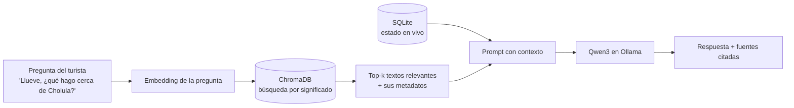
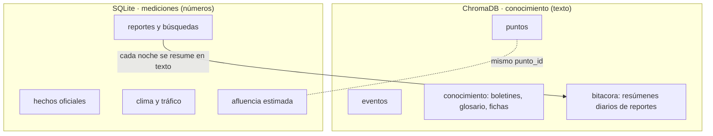
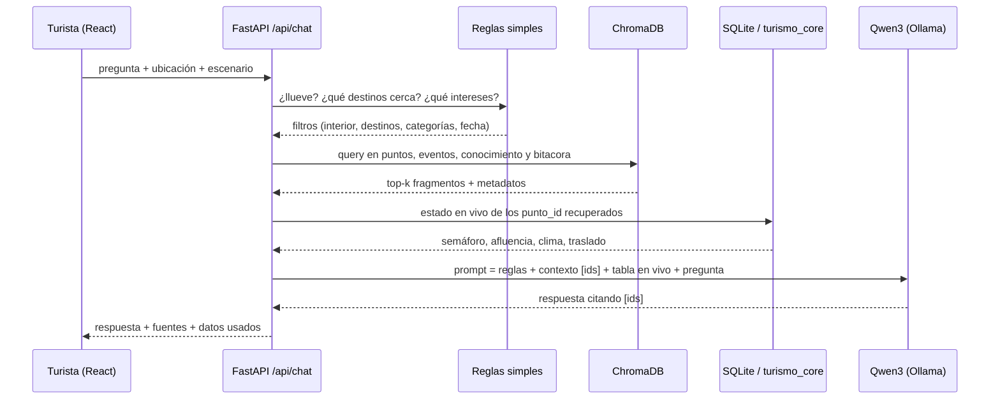

# 🧠 ChromaDB y RAG

> [!info] De dónde sale esta nota
> El 2026-10-14 el asesor, **Rafael Pérez Aguirre**, recomendó construir nuestra propia base de conocimiento y consultarla con **RAG** usando **ChromaDB**. Esta nota explica qué es cada cosa, cómo encaja con lo que ya teníamos ([[05 - Arquitectura y MCP]]) y cómo se conecta con el backend en FastAPI ([[05c - Backend FastAPI y frontend React]]).
> Lo investigué en la documentación oficial el 2026-10-14. Los fragmentos de código son **de referencia**: los nombres marcados **(verificar)** se confirman al implementar.

## 1. 🤔 Qué es RAG, en simple

**RAG** (*Retrieval-Augmented Generation*, "generación aumentada con recuperación") es una forma de usar un modelo de lenguaje **sin que invente**:

1. **Recuperar:** ante una pregunta, se buscan en **nuestra** base los textos más relacionados.
2. **Aumentar:** esos textos se pegan en el *prompt* como contexto.
3. **Generar:** el modelo responde **solo con ese contexto** y cita de dónde salió cada dato.



> [!tip] Por qué le sirve al proyecto
> - El modelo (Qwen3, ver [[05 - Arquitectura y MCP]]) **no sabe nada de Puebla**: el RAG le da nuestros datos depurados.
> - Responde a la regla de la convocatoria de que un chatbot genérico no basta ([[01 - Convocatoria y reglas]]): la IA trabaja sobre **una base propia, documentada y con fuentes**.
> - Cada respuesta trae sus **fuentes**, así que el jurado puede ver de dónde salió cada dato.

## 2. 🗄️ Qué es ChromaDB

| Dato | Detalle |
|---|---|
| Qué es | Base de datos **vectorial** de código abierto: guarda textos junto con su *embedding* y sus metadatos, y busca por **significado** |
| Licencia | **Apache 2.0** (gratis, también para uso comercial) |
| Versión actual | `chromadb` **1.5.9** (PyPI, 2026-05-05); requiere Python ≥ 3.9 |
| Instalación | `uv add chromadb` |
| Dónde corre | Local (en el mismo proceso o como servidor) o en Chroma Cloud (de pago, **no lo usamos**) |
| Búsquedas | Vectorial, por palabra clave o regex sobre el texto, y **filtros por metadatos** al consultar |

### Conceptos clave

| Concepto | Qué es | En nuestro proyecto |
|---|---|---|
| **Colección** (*collection*) | Algo así como una "tabla" de ChromaDB | `puntos`, `eventos`, `conocimiento`, `bitacora` |
| **Documento** (*document*) | El texto que se guarda y se busca | La ficha de un atractivo, un párrafo del boletín… |
| **ID** | Identificador único del documento | `punto-12`, `boletin-2026-1-p3-c2` |
| **Embedding** | Lista de números que representa el **significado** del texto. Textos parecidos quedan "cerca" | Se calcula con un modelo local (sección 4) |
| **Metadatos** | Campos extra para filtrar | `destino`, `tipo`, `interior`, `categorias`, `fecha`… |
| **Distancia** | Qué tan lejos están dos embeddings | **Coseno** (lo configuramos; el valor por defecto es `l2`) |

## 3. ⚖️ ChromaDB no reemplaza a SQLite: se complementan

> [!important] La decisión de diseño más importante de esta nota
> ChromaDB es muy buena para **"encuéntrame textos que signifiquen algo parecido a esta pregunta"**, pero es mala para **contar, sumar o sacar promedios**: cuántos reportes hubo, la afluencia por hora o la derrama total.
> Por eso la base propia tiene **dos motores**, cada uno haciendo lo que hace bien.

| Pregunta | Motor | Por qué |
|---|---|---|
| "¿Qué lugar techado con historia hay cerca?" | **ChromaDB** | Búsqueda por significado + filtro `interior = True` |
| "¿Qué dice el gobierno sobre la concentración en Cholula?" | **ChromaDB** | Recupera el párrafo del boletín y lo cita |
| "¿Qué eventos hay este fin en Atlixco?" | **ChromaDB** | Texto del evento + filtro por fechas |
| "¿Qué tan lleno está la Pirámide ahora?" | **SQLite** | Afluencia estimada + reportes recientes (números, tiempo) |
| "¿Cuántos turistas se redirigieron hoy?" | **SQLite** | Conteo y agregación |
| "¿Cuánta derrama se movió?" | **SQLite** | Suma × gasto por visitante |



La **llave que une los dos mundos** es el `punto_id`: un documento de la colección `puntos` en ChromaDB lleva en sus metadatos el mismo `punto_id` que la tabla `punto` en SQLite ([[05 - Arquitectura y MCP]]).

## 4. 🔢 Embeddings: qué modelo usar

| Opción | Idioma | Dónde corre | Tamaño aprox. | Veredicto |
|---|---|---|---|---|
| `all-MiniLM-L6-v2` (el **default** de ChromaDB) | Pensado para **inglés** | Local (se descarga solo) | Pequeño | ❌ Malo para textos en español |
| **`bge-m3`** vía Ollama | **Multilingüe** (incluye español) | Ollama, local | ~1.2 GB | ✅ **Recomendado** |
| `nomic-embed-text-v2-moe` vía Ollama | ~100 idiomas | Ollama, local | Mediano | 🟡 Alternativa: probar contra `bge-m3` |
| Modelo multilingüe de `sentence-transformers` | Multilingüe | CPU, sin Ollama | Pequeño | 🟡 Respaldo si falta VRAM en la laptop |

> [!warning] Reglas de los embeddings
> 1. **El mismo modelo para indexar y para preguntar.** Si se cambia el modelo, hay que **reindexar todo**.
> 2. **VRAM de la laptop:** `qwen3:4b` (~2.5 GB) + `bge-m3` (~1.2 GB) ≈ 3.7 GB de 4 GB. Está justo; Ollama mueve a CPU lo que no quepa. Como en el stand solo se calcula el embedding de la pregunta (corto), en CPU también es rápido. **Probar el miércoles.**
> 3. El índice se puede construir en la **PC** (más rápida) y copiar la carpeta `data/chroma/` a la laptop.

## 5. 🚀 Modos de ejecución

| Modo | Código | Cuándo |
|---|---|---|
| En memoria | `chromadb.Client()` | Pruebas: al cerrar se pierde todo |
| **Persistente** | `chromadb.PersistentClient(path="data/chroma")` | Un solo proceso (solo FastAPI) |
| **Servidor local** | `chroma run --path data/chroma --port 8001` + `chromadb.HttpClient(host="localhost", port=8001)` | **Varios procesos** que comparten la base (FastAPI **y** el servidor MCP) |

> [!tip] Decisión sugerida
> - **Desarrollo:** `PersistentClient`, por simple.
> - **Demo:** servidor local en el **puerto 8001**, porque el 8000 es el de FastAPI. Así FastAPI y el servidor MCP leen la misma base sin pelearse por los archivos.
>
> El cambio se hace con una variable del `.env` (`CHROMA_HOST` vacío = persistente). **(verificar las opciones de `chroma run`)**

```python
# turismo_core/vector.py — una sola conexión para todo el proceso
import os
import chromadb
from chromadb.utils.embedding_functions import OllamaEmbeddingFunction  # (verificar nombre/parámetros)

_cliente = None

def cliente():
    global _cliente
    if _cliente is None:
        host = os.getenv("CHROMA_HOST")
        _cliente = (chromadb.HttpClient(host=host, port=int(os.getenv("CHROMA_PORT", "8001")))
                    if host else chromadb.PersistentClient(path="data/chroma"))
    return _cliente

EMBEDDINGS = OllamaEmbeddingFunction(
    url=os.getenv("OLLAMA_URL", "http://localhost:11434"),
    model_name=os.getenv("EMBED_MODEL", "bge-m3"),
)

def coleccion(nombre: str):
    return cliente().get_or_create_collection(
        name=nombre,
        embedding_function=EMBEDDINGS,
        configuration={"hnsw": {"space": "cosine"}},
    )
```

## 6. 📚 Colecciones del proyecto

| Colección | Un documento es… | Metadatos | ID | Se llena con | Se actualiza |
|---|---|---|---|---|---|
| **`puntos`** | Ficha en texto de un atractivo: qué es, para quién, qué hay cerca, horario, costo, tips | `punto_id`, `destino`, `tipo`, `interior` (bool), `categorias` (lista), `lat`, `lon`, `verificado` | `punto-{id}` | Catálogo (DENUE + SIC + INAH + OSM, [[04 - Fuentes de datos]]) + descripción escrita por el equipo | Al cambiar el catálogo |
| **`eventos`** | Descripción de un evento | `destino`, `punto_id`, `inicio` y `fin` (int `YYYYMMDD`), `impacto`, `verificado` | `evento-{id}` | Calendario curado con fuente oficial | Al cargar eventos |
| **`conocimiento`** | Un fragmento (~800 caracteres) de un boletín, del glosario del Observatorio o de una ficha de fuente o de modelo | `fuente`, `url`, `fecha` (int), `pagina`, `tipo_doc` | `{fuente}-p{pagina}-c{n}` | Boletines SEI (PDF), glosario, fichas ([[04b - Plantilla ficha de fuente de datos]]) | Al publicar un boletín nuevo |
| **`bitacora`** | Resumen diario de un punto en texto: "Sábado 17-oct, Z.A. de Cholula: 14 reportes, mayoría *lleno* de 11 a 14 h; con lluvia a las 15 h bajó a *normal*" | `punto_id`, `destino`, `fecha` (int), `n_reportes`, `nivel_promedio` | `bitacora-{punto}-{fecha}` | **Se genera** desde SQLite con una plantilla (sin LLM) | Cada noche |

> [!success] Así los reportes de los turistas alimentan el RAG
> Los reportes viven en SQLite (números). Cada noche, `resumir_bitacora.py` los convierte en **texto** y los guarda en `bitacora`. Así, preguntas como **"¿a qué hora conviene ir a Cholula en sábado?"** se responden con **lo que reportaron turistas reales**, y la respuesta lo cita. Mientras más se usa la app, más sabe el asistente.

## 7. 📥 Ingesta: cómo se llena ChromaDB

Script `scripts/indexar_chroma.py`. Corre después de `cargar_bd.py` en el pipeline ([[04 - Fuentes de datos]]).

**Reglas:**
- **IDs deterministas + `upsert`:** si se vuelve a correr el script, se actualizan los mismos documentos en lugar de duplicarlos.
- **Metadatos solo de tipos permitidos:** texto, número, booleano o listas de esos. **Nunca `None`**: si falta un dato, no se pone la llave.
- **Fechas como enteros** (`20261017`) para poder filtrar con `$gte` / `$lte`.
- **Fragmentos (chunks)** de ~800 caracteres con ~100 de traslape, cortando por párrafo. Cada fragmento guarda su página para poder citarla.
- **Sin datos personales:** a ChromaDB nunca entran reportes individuales, solo resúmenes agregados.

```python
# scripts/indexar_chroma.py (fragmento de referencia)
from turismo_core.vector import coleccion
from turismo_core.bd import leer_puntos  # lee la tabla punto de SQLite

puntos = coleccion("puntos")
filas = leer_puntos()

puntos.upsert(
    ids=[f"punto-{p.id}" for p in filas],
    documents=[p.ficha_texto for p in filas],
    metadatas=[{
        "punto_id": p.id,
        "destino": p.destino,
        "tipo": p.tipo,
        "interior": bool(p.interior),
        "categorias": p.categorias.split(","),   # lista → filtro $contains
        "lat": p.lat, "lon": p.lon,
        "verificado": bool(p.verificado),
    } for p in filas],
)
```

## 8. 🔎 Consultas con filtros

| Operador | Uso en el proyecto |
|---|---|
| `$eq`, `$ne` | `{"interior": {"$eq": True}}` cuando llueve |
| `$in`, `$nin` | `{"destino": {"$in": ["Cd. Puebla", "San Pedro Cholula", "Atlixco"]}}` |
| `$gte`, `$lte` | Eventos vigentes: `inicio <= hoy` y `fin >= hoy` |
| `$contains` (en lista) | `{"categorias": {"$contains": "historia"}}` |
| `$and`, `$or` | Combinar filtros |
| `where_document` + `$contains` / `$regex` | Buscar una palabra exacta en el texto (p. ej. "Catrinas") |

```python
# Lugares techados, de historia, en la zona piloto
puntos.query(
    query_texts=["algo de historia para una tarde lluviosa"],
    n_results=5,
    where={"$and": [
        {"interior": {"$eq": True}},
        {"categorias": {"$contains": "historia"}},
        {"destino": {"$in": ["Cd. Puebla", "San Pedro Cholula", "San Andrés Cholula", "Atlixco"]}},
    ]},
)

# Eventos vigentes hoy
hoy = 20261017
coleccion("eventos").query(
    query_texts=["festival de Día de Muertos"],
    n_results=3,
    where={"$and": [{"inicio": {"$lte": hoy}}, {"fin": {"$gte": hoy}}]},
)
```

El resultado trae `ids`, `documents`, `metadatas` y `distances`. Una distancia coseno chica significa "muy parecido".

## 9. 🔁 El flujo RAG del asistente, paso a paso

> [!tip] Diseño pensado para un modelo chico
> Un modelo de 4B se equivoca más cuando tiene que **decidir** qué herramienta llamar. Por eso el backend hace en **código normal** todo lo que se puede decidir sin IA: filtros, búsqueda y estado en vivo. El modelo solo **redacta** con lo que le damos. El *tool calling* queda como mejora opcional.



1. **Filtros por reglas (sin LLM):** si el clima dice lluvia, `interior = True`; destinos a menos de X min según la matriz de traslados; categorías según los intereses que eligió el turista.
2. **Recuperar:** top 5 de `puntos`, top 3 de `eventos` vigentes y top 3 de `conocimiento` y `bitacora`.
3. **Estado en vivo:** para cada `punto_id` recuperado, `turismo_core` da semáforo, afluencia, clima y traslado (SQLite).
4. **Prompt** (sección 10).
5. **Respuesta:** el texto del modelo + la lista de fuentes, que arma **el backend** (no el modelo, para que no la invente).

## 10. 📝 Plantilla del prompt

```text
Eres el asistente turístico de Puebla. Responde en español, en máximo 6 líneas.
REGLAS:
- Usa SOLO la información de CONTEXTO y ESTADO EN VIVO. Si no está ahí, di "No tengo ese dato".
- Cita la fuente de cada dato con su id entre corchetes, por ejemplo [punto-12].
- Si un lugar está en rojo, no lo recomiendes: ofrece la alternativa en verde más cercana.

CONTEXTO:
[punto-12] Museo Regional de Cholula: ... (techado, historia) ...
[evento-3] Valle de Catrinas, Atlixco, del 2-oct al 9-nov ...
[bitacora-7-20261010] Sábado 10-oct, Z.A. de Cholula: mayoría "lleno" de 11 a 14 h ...

ESTADO EN VIVO (calculado ahora):
| punto | semáforo | afluencia | lluvia 15 h | traslado |
| punto-7 Z.A. de Cholula | rojo | muy alta (confirmado por turistas) | 70% | 45 min |
| punto-12 Museo Regional | verde | baja (estimado) | techado | 20 min |

PREGUNTA: {pregunta}
```

Con temperatura baja (0.2) y el modo de razonamiento de Qwen3 **apagado** para que responda rápido ([[05 - Arquitectura y MCP]]).

## 11. 🎯 Recomendador semántico

El recomendador "mejor ve a…" ([[03 - Ideas y alternativas]]) usa ChromaDB:

1. Toma la **ficha del punto saturado** y busca en `puntos` los más parecidos por significado. Así, "zona arqueológica con museo" encuentra otros lugares de historia, aunque no compartan palabras exactas.
2. Filtra los que estén en 🔴 o cerrados (estado de SQLite).
3. Ordena por puntaje combinado:

$$
\text{puntaje} = 0.5 \cdot \text{similitud} + 0.3 \cdot \text{conveniencia} + 0.2 \cdot \text{cercanía}
$$

donde $\text{similitud} = 1 - \text{distancia coseno}$. Los pesos son un **supuesto documentado** y se ajustan con `busqueda.aceptada`.

## 12. 📏 Cómo se evalúa (para la ficha del modelo)

| Prueba | Cómo | Meta |
|---|---|---|
| **Recuperación** | 15 preguntas de prueba con el documento correcto anotado a mano; ¿aparece en el top 5? (*hit@5*) | ≥ 80% |
| **Fidelidad** | En esas 15 respuestas, ¿cada cifra está en el contexto que recibió el modelo? | 100%; si inventa, se ajusta el prompt |
| **"No sé"** | 5 preguntas sin respuesta en la base | Que diga "No tengo ese dato" |
| **Tiempo** | Pregunta → respuesta en la laptop del stand | < 8 s |

Los resultados van en `datos://modelos` y en la documentación del modelo de IA que pide la convocatoria ([[06 - Plan de trabajo y roles]]).

## 13. ⚠️ Límites y riesgos

| Riesgo | Mitigación |
|---|---|
| Embedding en inglés da malos resultados en español | Usar `bge-m3` (multilingüe); probar con las 15 preguntas |
| Fragmentos mal cortados pierden contexto | Cortar por párrafo, con traslape, y guardar la página |
| Se mezcla información vieja (p. ej. el CSV de atractivos de 2018) | Solo entra al índice lo marcado `verificado`; cada fragmento lleva su `fecha` |
| Cambiar el modelo de embeddings rompe el índice | Reindexar con un solo comando (`indexar_chroma.py`) |
| Dos procesos abren la misma carpeta de ChromaDB | Servidor local (`chroma run`) en la demo |
| El modelo ignora las reglas | Pocas reglas, ejemplos en el prompt, temperatura baja y prueba de fidelidad |

## 📎 Fuentes consultadas (2026-10-14)

- ChromaDB, introducción: <https://docs.trychroma.com/docs/overview/introduction>
- Clientes: <https://docs.trychroma.com/docs/run-chroma/clients.md>
- Funciones de embedding: <https://docs.trychroma.com/docs/embeddings/embedding-functions.md>
- Filtros `where`: <https://docs.trychroma.com/reference/where-filter.md>
- Configurar la distancia: <https://docs.trychroma.com/docs/collections/configure.md>
- Integración con Ollama: <https://docs.trychroma.com/integrations/embedding-models/ollama> · <https://cookbook.chromadb.dev/integrations/ollama/embeddings/>
- `chromadb` en PyPI: <https://pypi.org/project/chromadb/>
- Índice completo de la documentación: <https://docs.trychroma.com/llms.txt>

## 🔗 Relacionado
- [[05 - Arquitectura y MCP]]
- [[05c - Backend FastAPI y frontend React]]
- [[04 - Fuentes de datos]]

---
#hackathon #rag
