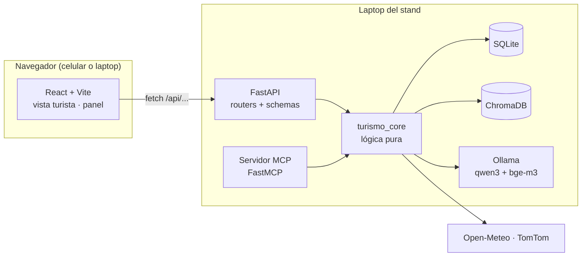

# 🌐 Backend FastAPI y frontend React

> [!info] Decisión del 2026-10-14
> Por recomendación del asesor (**Rafael Pérez Aguirre**), la página web se hace con **FastAPI** de backend y **React + Vite** de frontend, en lugar de Streamlit. Las dos son herramientas que ya usamos en clase:
> - FastAPI en Lenguajes de computación: [[Actividad 11 - Analizador de complejidad]] y [[Actividad 12 - Búsqueda informada y heurística]].
> - React + Vite en Diseño de Software: [[PRIMEROS PASOS CON REACT]], [[CATÁLOGO Y SOLICITUD EN REACT]] y [[POKEDEX CON FIREBASE Y FIRESTORE]].
>
> El panorama general está en [[05 - Arquitectura y MCP]], y la parte de ChromaDB en [[05b - ChromaDB y RAG]].

## 1. 🧱 Cómo se reparte el trabajo



| Pieza | Responsabilidad | No hace |
|---|---|---|
| **React + Vite** | Pantallas, mapa, botones, estado de la interfaz | Cálculos ni acceso a la base |
| **FastAPI** | Traducir HTTP ↔ Python: rutas, validación con Pydantic, errores | Lógica de negocio |
| **`turismo_core`** | Toda la lógica: afluencia, semáforo, recomendador, RAG, reportes | No sabe nada de HTTP ni de MCP |
| **Servidor MCP** | Exponer las mismas funciones de `turismo_core` a clientes MCP | Lógica propia |

> [!tip] Es el mismo patrón que la Actividad 11
> "La lógica no sabe nada de la web": `main.py` solo traduce entre HTTP y la lógica, que se prueba con `pytest` sin levantar el servidor ([[Actividad 11 - Analizador de complejidad]]). Aquí además se gana algo: **FastAPI y el servidor MCP comparten exactamente las mismas funciones**, así que nunca dan respuestas distintas.

## 2. ⚙️ Backend: FastAPI

### 2.1 Estructura

```text
backend/
├── pyproject.toml            # proyecto uv
├── app/
│   ├── main.py               # crea la app, CORS, routers, archivos estáticos
│   ├── schemas.py            # modelos Pydantic de entrada y salida
│   └── routers/
│       ├── puntos.py         # catálogo, estado y semáforo
│       ├── turista.py        # recomendar, sesiones, reportes
│       ├── chat.py           # asistente RAG
│       └── panel.py          # vistas de gobierno
├── turismo_core/             # lógica pura (ver 05)
│   ├── bd.py · vector.py · llm.py
│   ├── afluencia.py · semaforo.py · estado.py · conveniencia.py · recomendador.py
│   ├── rag.py · reportes.py · clima.py · trafico.py · escenarios.py
├── mcp_server/server.py      # FastMCP con las mismas funciones
├── scripts/                  # pipeline e indexado
└── tests/                    # pytest sobre turismo_core
```

### 2.2 Endpoints

| Método | Ruta | Entrada | Salida | Usa |
|---|---|---|---|---|
| GET | `/api/salud` | — | Estado de SQLite, ChromaDB, Ollama y APIs | Revisión antes de la demo |
| GET | `/api/escenarios` | — | Lista: `ahora`, `puente_lluvia`, … | Selector de escenario |
| GET | `/api/puntos` | `destino?`, `tipo?` | Catálogo de la zona piloto | Mapa |
| GET | `/api/semaforo` | `escenario?` | Todos los puntos con color, afluencia y confianza | Mapa |
| GET | `/api/puntos/{id}/estado` | `escenario?` | Semáforo, afluencia, clima por hora, traslado, horario, eventos | Tarjeta de un punto |
| POST | `/api/sesiones` | `perfil` (intereses) | `sesion_id` (lo genera el servidor) | Al abrir la app |
| POST | `/api/recomendar` | `sesion_id`, `punto_id?`, `origen`, `intereses`, `horas`, `escenario?` | Alternativa + razón + `busqueda_id` | "Mejor ve a…" |
| POST | `/api/busquedas/{id}/aceptar` | — | ok | El turista eligió la alternativa |
| POST | `/api/reportes` | `sesion_id`, `punto_id`, `nivel`, `espera_min?`, `distancia_m?` | Reporte con `estado` y `peso` + estado nuevo del punto | Botón "¿Cómo está?" |
| POST | `/api/chat` | `sesion_id`, `pregunta`, `origen?`, `escenario?` | `respuesta`, `fuentes[]`, `estado_usado[]` | Asistente ([[05b - ChromaDB y RAG]]) |
| GET | `/api/panel/afluencia` | `escenario?` | Afluencia por punto (para el mapa de calor) | Panel |
| GET | `/api/panel/redirecciones` | `desde`, `hasta` | De dónde a dónde y por qué | Panel |
| GET | `/api/panel/derrama` | `desde`, `hasta` | Derrama redistribuida medida | Panel |
| GET | `/api/panel/semaforo-estatal` | `mes`, `anio` | Pronóstico de los 20 destinos | Panel |
| POST | `/api/panel/ajustes` | `punto_id`, `color`, `motivo`, `horas` | Ajuste manual guardado + estado nuevo del punto | Panel: "Fijar color" (cierre, obra, fila) |
| GET | `/api/panel/umbrales` | — | Umbrales `bajo`/`alto` de cada punto y su método | Panel: explicar por qué un punto está en ese color |

Swagger queda automático en `http://localhost:8000/docs`, como en clase, y sirve para probar cada endpoint sin frontend.

### 2.3 Código de referencia

```python
# app/schemas.py
from typing import Literal
from pydantic import BaseModel, Field

class ReporteIn(BaseModel):
    sesion_id: str
    punto_id: int
    nivel: Literal[1, 2, 3] = Field(description="1 vacío, 2 normal, 3 lleno")
    espera_min: int | None = Field(default=None, ge=0, le=300)
    distancia_m: float | None = Field(default=None, ge=0)

class ChatIn(BaseModel):
    sesion_id: str
    pregunta: str = Field(min_length=3, max_length=500)
    origen_punto_id: int | None = None
    escenario: str = "ahora"

class ChatOut(BaseModel):
    respuesta: str
    fuentes: list[dict]        # id, título, url: los arma el backend, no el modelo
    estado_usado: list[dict]   # la tabla en vivo que recibió el modelo
```

```python
# app/main.py
from contextlib import asynccontextmanager
from fastapi import FastAPI
from fastapi.middleware.cors import CORSMiddleware
from fastapi.staticfiles import StaticFiles
from app.routers import puntos, turista, chat, panel
from turismo_core import vector, bd

@asynccontextmanager
async def lifespan(app: FastAPI):
    bd.iniciar()          # abre SQLite y aplica el esquema si hace falta
    vector.cliente()      # abre ChromaDB una sola vez
    yield

app = FastAPI(title="Puebla Ahora API", lifespan=lifespan)

app.add_middleware(
    CORSMiddleware,
    allow_origins=["http://localhost:5173"],   # Vite en desarrollo
    allow_methods=["*"], allow_headers=["*"],
)

for r in (puntos, turista, chat, panel):
    app.include_router(r.router, prefix="/api")

# En la demo, FastAPI también sirve el frontend ya compilado (un solo puerto)
app.mount("/", StaticFiles(directory="../frontend/dist", html=True), name="web")
```

```python
# app/routers/turista.py (fragmento)
from fastapi import APIRouter
from app.schemas import ReporteIn
from turismo_core import reportes

router = APIRouter(tags=["turista"])

@router.post("/reportes")
def crear_reporte(r: ReporteIn):
    # La lógica (filtros antispam, peso, fusión) vive en turismo_core
    return reportes.registrar(**r.model_dump())
```

> [!note] Funciones `def` y no `async def`
> ChromaDB y `sqlite3` son **síncronos**. Si los endpoints se declaran con `def` normal, FastAPI los corre en un *pool* de hilos y no bloquea el servidor. Si se usara `async def` con llamadas síncronas adentro, una consulta lenta al LLM congelaría a todos los usuarios.

### 2.4 Datos en vivo sin Streamlit

Antes, la caché la hacía `st.cache_data`. Ahora:
- **Caché con tiempo de vida** dentro de `turismo_core` (p. ej. `cachetools.TTLCache`): clima 60 min y tráfico 15 min. La primera petición después de que vence la caché consulta la API y **guarda** la respuesta en SQLite ([[05 - Arquitectura y MCP]]).
- **Si la API falla:** se usa la última fila guardada y la respuesta dice `"actualizado_hace_min": 47`.
- **El panel se refresca solo** cada 5 s con `setInterval` en React. Es más simple que WebSockets y basta para que el evaluador vea su reporte reflejado. WebSockets o SSE quedan para fase 2.

### 2.5 Cómo se corre

```bash
cd backend
uv sync
ollama pull qwen3:4b && ollama pull bge-m3
uv run python scripts/cargar_bd.py && uv run python scripts/indexar_chroma.py
uv run chroma run --path data/chroma --port 8001      # terminal 1 (solo en la demo)
uv run uvicorn app.main:app --reload --port 8000      # terminal 2 · Swagger en /docs
```

## 3. 🎨 Frontend: React + Vite

### 3.1 Creación (igual que en clase)

```bash
npm create vite@latest frontend -- --template react
cd frontend
npm install
npm install react-router-dom leaflet react-leaflet recharts
npm run dev          # http://localhost:5173
```

| Paquete | Para qué | Nota |
|---|---|---|
| `react-router-dom` | Dos rutas: `/` (turista) y `/panel` (gobierno) | |
| `leaflet` + `react-leaflet` | Mapa con marcadores de colores | Mosaicos de OpenStreetMap: gratis con atribución. **(verificar** qué versión de `react-leaflet` corresponde a la versión de React que instale Vite**)** |
| `recharts` | Gráficas del panel | |

### 3.2 Estructura de `src/`

```text
src/
├── main.jsx · App.jsx          # rutas
├── api/cliente.js              # todas las llamadas fetch en un solo lugar
├── pages/
│   ├── Turista.jsx             # "¿A dónde voy ahora?"
│   └── Panel.jsx               # vista de la Secretaría
├── components/
│   ├── Mapa.jsx                # marcadores 🟢🟡🔴
│   ├── TarjetaPunto.jsx        # estado del punto + botón "¿Cómo está?"
│   ├── Recomendacion.jsx       # "Mejor ve a…" con su razón
│   ├── BotonReporte.jsx        # vacío / normal / lleno
│   ├── Chat.jsx                # asistente con fuentes citadas
│   ├── SelectorEscenario.jsx   # "ahora" / "sábado de puente con lluvia"
│   ├── SelectorUbicacion.jsx   # "¿dónde estás?" (lista de puntos)
│   └── panel/ (MapaCalor.jsx, Redirecciones.jsx, Derrama.jsx)
├── hooks/
│   ├── useSesion.js            # pide sesion_id al backend y lo guarda
│   └── useSondeo.js            # refresca datos cada N segundos
└── data/intereses.js           # historia, gastronomía, naturaleza…
```

Es la misma organización `components/` + `data/` de [[PRIMEROS PASOS CON REACT]].

### 3.3 Estado y datos

| Estado | Dónde vive | Por qué |
|---|---|---|
| `escenario`, `sesionId`, `origen`, `intereses` | `App.jsx`, pasado por props | Lo usan varias pantallas: **levantar el estado** ([[CATÁLOGO Y SOLICITUD EN REACT]]) |
| `semaforo` (lista de puntos) | `Turista.jsx` | Se recarga al cambiar el escenario |
| `puntoSeleccionado`, `recomendacion` | `Turista.jsx` | |
| `mensajes` del chat | `Chat.jsx` | Solo le importa al chat |

```jsx
// api/cliente.js — mismo patrón async/await + try/catch de la Pokédex
const API = import.meta.env.VITE_API_URL ?? '/api'

export async function obtenerSemaforo(escenario) {
  const res = await fetch(`${API}/semaforo?escenario=${escenario}`)
  if (!res.ok) throw new Error('No se pudo cargar el semáforo')
  return res.json()
}

export async function enviarReporte(reporte) {
  const res = await fetch(`${API}/reportes`, {
    method: 'POST',
    headers: { 'Content-Type': 'application/json' },
    body: JSON.stringify(reporte),
  })
  return res.json()
}
```

```jsx
// pages/Turista.jsx (fragmento) — useEffect que depende del escenario
const [semaforo, setSemaforo] = useState([])
useEffect(() => {
  async function cargar() {
    try { setSemaforo(await obtenerSemaforo(escenario)) }
    catch (e) { setError(e.message) }
  }
  cargar()
}, [escenario])
```

Es el mismo `useEffect` con una función `async` adentro que se usó en [[POKEDEX CON FIREBASE Y FIRESTORE]].

### 3.4 Desarrollo sin problemas de CORS

En desarrollo, Vite puede **reenviar** `/api` al backend, y así el navegador cree que todo viene del mismo origen:

```js
// vite.config.js
export default defineConfig({
  plugins: [react()],
  server: { proxy: { '/api': 'http://localhost:8000' } },
})
```

## 4. 📱 La demo con QR, a costo $0 y sin nube

Como el modelo corre en la laptop (Ollama), la app **no se publica en internet**:

1. La laptop y los celulares de los evaluadores se conectan al **hotspot** del equipo.
2. `npm run build` genera `frontend/dist/`, y **FastAPI lo sirve** en el mismo puerto que la API.
3. `uvicorn app.main:app --host 0.0.0.0 --port 8000`.
4. El QR de la mampara apunta a `http://<IP-de-la-laptop>:8000`.

> [!warning] Dos trampas del navegador sin HTTPS
> En `http://` a una IP de la red local (no `localhost`), el navegador del celular **no da acceso a**:
> - **GPS** (`navigator.geolocation`).
> - **`crypto.randomUUID()`**.
>
> Por eso:
> - La ubicación se elige con **`SelectorUbicacion`** ("Estoy en: Zócalo / Pirámide / …"). Según las reglas de [[05 - Arquitectura y MCP]], un reporte sin GPS vale la mitad.
> - El `sesion_id` lo genera **el backend** (`POST /api/sesiones`), no el navegador.
>
> Si se quiere GPS, la opción es HTTPS con certificado autofirmado, pero el celular muestra una advertencia. **No vale la pena para la demo.**

> [!tip] Revisar antes del viernes
> - Que el **firewall de Windows** permita conexiones entrantes al puerto 8000 en la laptop.
> - Que el hotspot **no aísle a los clientes**: algunos celulares impiden que los dispositivos conectados se vean entre sí.
> - Llevar un plan B: la laptop con la app abierta y el video de respaldo.

## 5. ✅ Cómo se prueba

| Qué | Herramienta |
|---|---|
| Lógica (`turismo_core`) | `pytest`, sin servidor, como en la Actividad 11 |
| Endpoints | Swagger (`/docs`) y `fastapi.testclient.TestClient` |
| Frontend | A mano con el escenario "sábado de puente con lluvia"; `npm run lint` antes del commit (el CI de clase falla con errores de lint) |
| Demo completa | En la laptop, **sin internet**, con un celular conectado al hotspot |

## 🔗 Relacionado
- [[05 - Arquitectura y MCP]]
- [[05b - ChromaDB y RAG]]
- [[06 - Plan de trabajo y roles]]

---
#hackathon #fastapi #react
