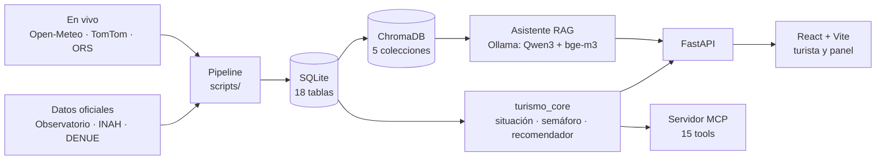

# Puebla Ahora
## Cómo está hecho

"¿A dónde voy ahora?": el turista en tiempo real

Hackathon Puebla Turística 360° · 2026-10-16

Axel García Arellano · Angel Rugerio Jiménez · Diego Navarro Sánchez

---

## Qué hace

1. **Semáforo en vivo** de 23 lugares de la zona piloto Puebla–Cholula–Atlixco
2. **"Mejor ve a…"**: si un lugar está lleno, cerrado o se moja, propone otro lugar u otra hora, y explica por qué
3. **"¿Cómo está?"**: reportes de turistas (vacío / normal / lleno) que corrigen la estimación
4. **Asistente** con IA local que responde solo con nuestros datos y cita la fuente
5. **Panel de la Secretaría**: afluencia, redirecciones, derrama redistribuida y control manual del color

---

## Arquitectura

Una sola fuente de verdad: `situacion(con, momento)`. La API, el recomendador y el MCP dicen lo mismo.

---

## Datos: lo oficial

| Fuente | Qué aporta |
|---|---|
| Observatorio Turístico de Puebla | 20 centros turísticos, 9 indicadores, mensual 2017–jun 2026 |
| INAH, reporte detallado Puebla | 19 recintos, visitas mensuales 2023–sep 2026 |
| DENUE (INEGI), 05/2026 | 19,974 establecimientos cargados; 4,015 de comida y hospedaje cerca de los lugares van al asistente |
| Catálogo del equipo | 23 lugares verificados, con fuente por fila |
| Eventos | 11, todos con fuente; solo los verificados mueven el modelo |

Cada archivo original queda en `data/raw/` con su huella SHA-256 (`manifiesto_raw.csv`).

---

## Datos: lo que llega en vivo

- **Open-Meteo**: probabilidad de lluvia, milímetros y temperatura por hora en cada lugar (CC BY 4.0)
- **TomTom Routing**: tráfico en 30 corredores entre 6 anclas, cada 30 min de 8:00 a 20:00
- **OpenRouteService**: matriz de traslados en coche y a pie entre los 23 lugares
- **Reportes de turistas**: el único dato de "gente ahora" que no es estimado

Todo con planes gratuitos, sin tarjeta. **Costo de operación: $0.**

---

## Afluencia estimada

No existe un contador de personas en vivo en Puebla, así que se estima:

> estimación = base del mes (oficial) × f_día × f_hora × f_evento × f_clima

(`turismo_core/afluencia.py`. El factor de día incluye los festivos; el de evento solo usa eventos verificados.)

- 4,416 estimaciones: 23 lugares × 24 horas × hoy y 7 días más
- **Supuesto, y se dice:** los factores de día y hora son del equipo, porque no hay fuente pública de afluencia por hora
- Los reportes de los turistas corrigen la estimación en tiempo real

---

## Semáforo: cada lugar contra sí mismo

- **Verde**: menos lleno que el 60 % de **sus propias** horas abiertas (2023–2025)
- **Amarillo**: entre el 60 % y el 85 %
- **Rojo**: más lleno que el 85 % de sus horas
- **Cerrado**: fuera de horario. Los horarios salen solo de páginas oficiales, no de OpenStreetMap

La Catedral no compite con el Zócalo: cada uno tiene sus umbrales. Si la Secretaría fija un color (obra, cierre), ese color gana y se muestra el motivo.

---

## Reportes "¿Cómo está?"

- La estimación vale lo mismo que unos **2 reportes recientes**
- Un reporte pierde peso: a los 45 min vale cerca de un tercio y a las 3 h ya no cuenta
- Con 3 o más reportes válidos en la última hora: **"confirmado por turistas"**
- Filtros: uno por persona y lugar cada 30 min; no se aceptan de lugares cerrados; sin GPS vale la mitad; a más de 500 m se marca como dudoso
- **Privacidad (RN_07):** la ubicación nunca sale del celular; solo viaja la distancia al lugar

---

## "Mejor ve a…"

Si el lugar pedido está en rojo, cerrado o es al aire libre con lluvia fuerte, se busca otro que:

- nunca esté en rojo y esté abierto
- se parezca (mismos intereses: historia, arte, naturaleza…)
- esté a menos de 1 h de traslado; con lluvia, solo techados

**Puntaje** = parecido 30 % + conveniencia 70 %. La conveniencia pesa afluencia 40 %, clima 25 % y traslado 35 %.

También propone **otra hora**: "o regresa a las 10:00, cuando estará en verde".

---

## Asistente: el backend calcula, el modelo solo redacta

- **ChromaDB**, 5 colecciones: lugares (23), eventos (2), conocimiento y métodos (41), establecimientos del DENUE (4,015 a ≤ 1 km para comer y ≤ 2 km para dormir) y bitácora
- **Embeddings** `bge-m3`. **Modelo** Qwen3 local con Ollama: `qwen3:8b` en la PC, `qwen3:4b` en la laptop
- El backend arma el estado en vivo: color, techado, visita sugerida, traslado o "sin dato"
- Las citas `[punto-12]` se validan; las inválidas se quitan del texto
- Si no hay dato: "No tengo ese dato". Si llueve y nada techado está abierto, el backend responde con un texto fijo, sin el modelo

---

## Asistente: evaluación

28 preguntas, incluidas las 3 sugeridas del chat. `qwen3:8b`, momento 2026-10-16 13:00:

| Métrica | Resultado |
|---|---|
| Recuperó el documento esperado | 23/23 |
| Sin números inventados | 28/28 |
| "No tengo ese dato" cuando no hay dato | 5/5 |
| Citas válidas | 28/28 |
| Atributos correctos (techado, color, tranquilo) | 28/28 |
| Tiempo | 4.7 s de promedio, 21.9 s de máximo |

Detalle pregunta por pregunta en `backend/data/processed/evaluacion_rag.md`.

---

## MCP: los mismos datos para cualquier agente

Servidor `puebla_ahora_mcp` (SDK oficial, FastMCP), **15 tools**:

`que_hago_ahora` · `estado_punto` · `semana_punto` · `recomendar_alternativa` · `tiempo_traslado` · `buscar_punto` · `eventos` · `afluencia_zona` · `semaforo_estatal` · `historico_destino` · `derrama` · `redirecciones` · `buscar_conocimiento` · `preguntar_asistente` · `reportar`

Llaman a `servicio`, `panel` y `rag`, igual que FastAPI. Solo `puebla_reportar` escribe.

---

## App del turista y panel

- **FastAPI**: 17 endpoints; también sirve el frontend compilado en un solo puerto
- **React + Vite** con Leaflet, en español e inglés
- Ficha del lugar: color, "más lleno de lo normal", espera reportada, "hoy lo más tranquilo…" y la **semana por hora** ("¿cuándo me conviene ir?")
- "Datos en vivo: clima de hace X min · tráfico de hace Y min"
- Panel: redirecciones aceptadas, derrama redistribuida y nueva, reportes, umbrales por lugar, semáforo estatal y "fijar el color"

---

## Calidad

- **111 pruebas** automáticas (pytest) que corren solas cada vez que se edita el backend
- **20 revisiones** de la base en cada pipeline (`validar_bd`)
- Evaluación del asistente repetible (`scripts.evaluar_rag`)
- Probado en el navegador de punta a punta, sin errores de consola
- Reglas en el repo (`CLAUDE.md`): nada inventado, cada dato con su fuente y los supuestos escritos

---

## Lo que no hacemos (todavía)

- No contamos personas: estimamos y los turistas corrigen
- Los factores de día y hora son supuestos del equipo
- La ubicación en el celular necesita HTTPS; por la red del stand la app usa el lugar que eligió el turista
- **Fase 2:** alertas, reservar horario y cámaras de conteo
- Por decidir: planear otro día u hora y "¿y si llueve?" como función propia

---

## En el stand

1. Laptop con la zona inalámbrica de Windows y el puerto 8000 abierto
2. `PUEBLA_DEMO=1 uv run uvicorn app.main:app --host 0.0.0.0 --port 8000`
3. QR → `http://<IP-laptop>:8000` en el celular del jurado
4. Demo en vivo, con la hora real

Guía completa: `INSTALAR_LAPTOP.md`
