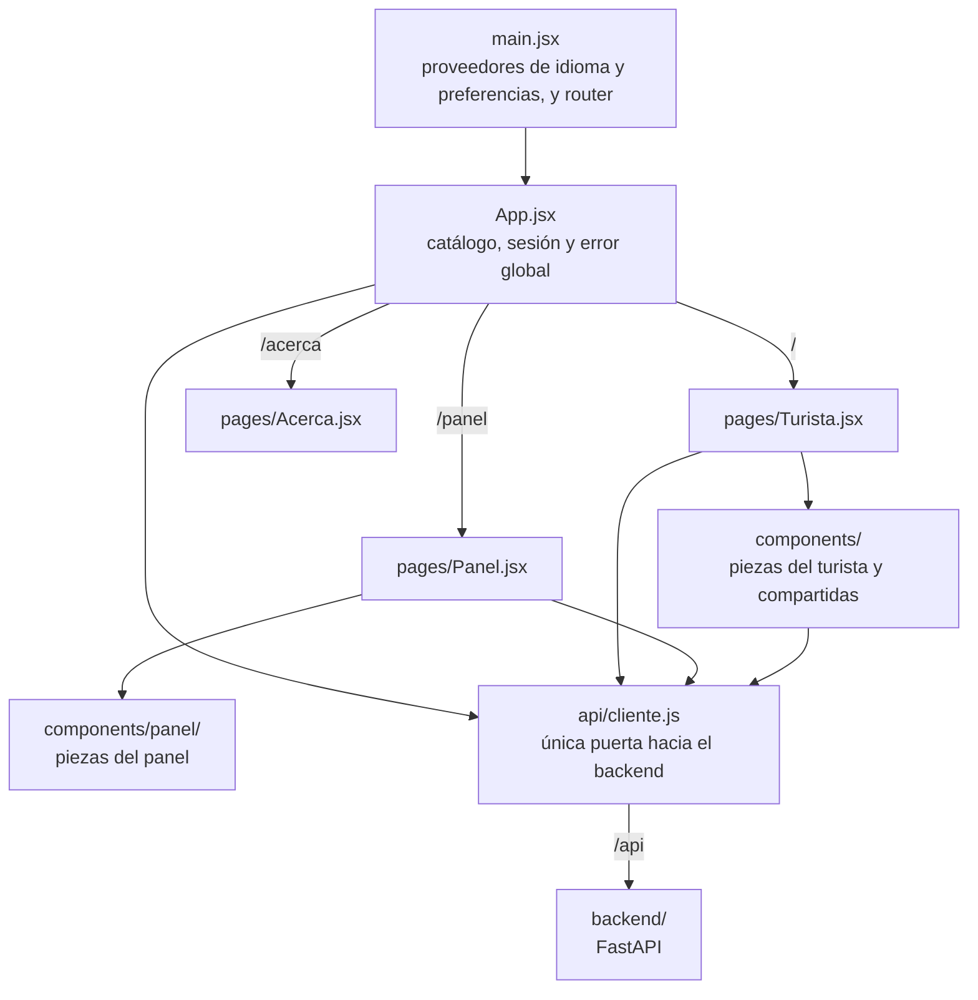

# Frontend

## Qué es

La interfaz web de RUMBO, en **React 19 + Vite 8**, con la app del turista y el panel de la Secretaría de Turismo. Responsable: Angel.

## Para qué sirve

| Ruta      | Pantalla | Qué permite                                                                                              |
| --------- | -------- | -------------------------------------------------------------------------------------------------------- |
| `/`       | Turista  | Elegir intereses, ver el mapa y la lista con semáforo, abrir la ficha de un lugar, recibir "Mejor ve a…", reportar "¿Cómo está?" y usar el asistente |
| `/panel`  | Panel    | Consultar indicadores agregados, mapa de calor, redirecciones y umbrales, y fijar el color de un lugar   |
| `/acerca` | Acerca   | Consultar atribuciones, licencias y aviso de privacidad                                                  |

## Cómo está construido

| Tecnología                  | Uso                                     |
| --------------------------- | --------------------------------------- |
| React 19 y React Router 7   | Interfaz y rutas                        |
| Vite 8                      | Servidor de desarrollo y compilación    |
| Leaflet y React Leaflet     | Mapas                                   |
| `@fontsource-variable/inter` | Tipografía Inter, sin depender de internet |
| oxlint                      | Revisión del código con `npm run lint`  |

El proyecto no tiene pruebas automatizadas de frontend. `recharts` está en `package.json`, pero `src/` no lo importa.



- **Datos:** la app no tiene datos propios. Todas las llamadas pasan por `src/api/cliente.js`, y los componentes usan los nombres del backend tal cual (`id`, `clave`, `color`, `razon`, `nivel`, `traslado.minutos`…). El contrato está en [`backend/app/schemas.py`](../backend/app/schemas.py).
- **Estado compartido:** `App.jsx` guarda el catálogo, la sesión y el error, y los baja por props.
- **Hora real:** no hay modo escenario; el semáforo siempre es el de la hora actual.
- **Sesión:** el login aún no existe. El turista usa una sesión anónima y `/panel` está abierto.
- **Lo que se guarda en el navegador:** `localStorage` conserva idioma, preferencias y si ya se vio la guía de primer uso.
- **Ubicación:** las coordenadas no salen del navegador; al backend solo se le envía la distancia al lugar, al reportar.

## Qué contiene

```text
frontend/
├── index.html         # documento base de Vite
├── package.json       # dependencias y comandos
├── package-lock.json  # versiones exactas
├── vite.config.js     # proxy de /api y rutas estáticas del build
├── .oxlintrc.json     # reglas de oxlint
├── .gitignore         # dependencias, build y referencias de terceros
├── maqueta/
│   └── index.html     # maqueta de baja fidelidad con la que se diseñó la app
├── public/
│   ├── favicon.svg    # ícono de la pestaña
│   └── fotos/         # 46 fotos: 23 lugares, tamaño grande y -mini
└── src/
    ├── main.jsx       # punto de entrada
    ├── App.jsx        # estado compartido y rutas
    ├── index.css      # estilos de toda la app
    ├── api/           # cliente de la API
    ├── assets/        # logos de la página "Acerca de"
    ├── components/    # componentes de la app
    │   └── panel/     # componentes exclusivos del panel
    ├── data/          # constantes y funciones de apoyo
    ├── hooks/         # hooks propios
    ├── i18n/          # español e inglés
    ├── pages/         # una pantalla por ruta
    └── preferencias/  # opciones de lectura y accesibilidad
```

`node_modules/`, `dist/` y `webDesignInspo/` existen solo en cada computadora: no se suben a git.

### `src/pages/`

| Archivo       | Qué es                                                                                            |
| ------------- | ------------------------------------------------------------------------------------------------- |
| `Turista.jsx` | Pantalla principal: coordina inicio, mapa, lista, ficha, recomendación, reporte y asistente        |
| `Panel.jsx`   | Panel de la Secretaría, siempre en español, con interruptor para contar la actividad de demostración |
| `Acerca.jsx`  | Atribuciones, créditos de las fotos y aviso de privacidad                                          |

### `src/components/`

| Archivo               | Qué es                                                                       |
| --------------------- | ---------------------------------------------------------------------------- |
| `Cabecera.jsx`        | Navegación, hora, idioma y acceso a "Ver mejor"                              |
| `EnVivo.jsx`          | Indica la hora del semáforo que se está viendo                               |
| `AvisoError.jsx`      | Mensaje único de error, en el idioma de la persona                           |
| `Inicio.jsx`          | Primera pantalla: intereses, tiempo y punto de partida                       |
| `GuiaPrimerUso.jsx`   | Guía breve que se abre la primera vez                                        |
| `SelectorLugar.jsx`   | Selector de lugar con foto y búsqueda                                        |
| `OpcionesLectura.jsx` | "Ver mejor": letra, colores, contraste, voz e idioma                         |
| `BotonEscuchar.jsx`   | Lectura en voz alta con la API de voz del navegador                          |
| `Mapa.jsx`            | Mapa del turista con marcadores, calor y ubicación                           |
| `capaBase.js`         | Capas del mapa base, Esri Light Gray Canvas, y sus atribuciones              |
| `marcadores.js`       | Marcadores del semáforo: forma, color e ícono                                |
| `CapaCalor.jsx`       | Capa de calor por lugar                                                      |
| `ControlesMapa.jsx`   | Botones para acercar, alejar y centrar                                       |
| `Encuadrar.jsx`       | Ajusta la vista para mostrar todos los lugares; lo usa el mapa del panel     |
| `LeyendaMapa.jsx`     | Explica el calor y los marcadores                                            |
| `ListaPuntos.jsx`     | Lista de lugares ordenada por conveniencia                                   |
| `TodosLosLugares.jsx` | Vista "Ver todos" agrupada por estado                                        |
| `FiltrosLugares.jsx`  | Filtros de la lista y del mapa                                               |
| `TarjetaPunto.jsx`    | Ficha completa de un lugar                                                   |
| `Semana.jsx`          | "¿Cuándo me conviene ir?": tabla por día y hora                              |
| `Recomendacion.jsx`   | Resultado de "Mejor ve a…"                                                   |
| `BotonReporte.jsx`    | Reporte "¿Cómo está?"                                                        |
| `Chat.jsx`            | Asistente con citas numeradas                                                |
| `Foto.jsx`            | Foto de un lugar, con texto alternativo y crédito                            |
| `Semaforo.jsx`        | Etiqueta del semáforo con forma, color, ícono y texto                        |
| `IconoEstado.jsx`     | Ícono de un estado del semáforo                                              |

### `src/components/panel/`

| Archivo               | Qué es                                                      |
| --------------------- | ----------------------------------------------------------- |
| `Indicadores.jsx`     | Indicadores del día y derrama estimada                      |
| `MapaCalor.jsx`       | Mapa de calor con el semáforo                               |
| `Redirecciones.jsx`   | A dónde se redirigió a los turistas, solo en agregado       |
| `SemaforoEstatal.jsx` | Destinos del Observatorio en el mes                         |
| `Umbrales.jsx`        | Por qué cada lugar tiene su color                           |
| `FijarColor.jsx`      | Fija o quita manualmente el color de un lugar               |

### Otras carpetas de `src/`

| Archivo                       | Qué es                                                                              |
| ----------------------------- | ----------------------------------------------------------------------------------- |
| `api/cliente.js`              | Todas las llamadas a la API y sus códigos de error                                  |
| `assets/*.png`                | Logos de Intelligentia y Tech Capital Puebla 2026                                   |
| `data/semaforo.js`            | Textos, íconos y orden de los estados                                               |
| `data/formas.js`              | Silueta de cada estado del semáforo                                                 |
| `data/calor.js`               | Rampa de color e intensidad del mapa de calor                                       |
| `data/formato.js`             | Formato de horas, razones, traslados y pesos                                        |
| `data/fotos.js`               | Autor y licencia de cada foto, por `clave` del lugar                                |
| `data/geo.js`                 | Distancias calculadas en el navegador                                               |
| `data/intereses.js`           | Intereses y tiempos disponibles en el inicio                                        |
| `data/marca.js`               | Nombre de la app                                                                    |
| `hooks/useHoja.js`            | Hoja inferior arrastrable del celular                                               |
| `hooks/useDialogo.js`         | Foco y teclado en ventanas y paneles                                                |
| `hooks/useUbicacion.js`       | Ubicación del turista                                                               |
| `i18n/textos.js`              | Textos de la interfaz en español e inglés                                           |
| `i18n/Idioma.jsx`             | Proveedor del idioma                                                                |
| `i18n/contexto.js`            | Hook `useIdioma` y función `t()`                                                    |
| `i18n/backend.js`             | Traduce al inglés, por patrón, las frases que redacta el backend                    |
| `i18n/fichas.en.js`           | Descripciones del catálogo en inglés                                                |
| `preferencias/Preferencias.jsx` | Guarda las preferencias y las aplica como atributos de `<html>`                   |
| `preferencias/contexto.js`    | Hook `usePreferencias`, opciones y escalas                                          |

## Cómo se usa

La guía completa está en [`INSTALACION.md`](../INSTALACION.md). Primero se levanta el backend y después:

```bash
npm ci            # instala dependencias
npm run dev       # http://localhost:5173; Vite reenvía /api a localhost:8000
npm run lint      # revisa el código, antes de cada commit
npm run build     # genera dist/
npm run preview   # sirve el build localmente
```

Para apuntar a otra API se define `VITE_API_URL`; por defecto se usa `/api`.

### Demo con FastAPI

FastAPI sirve `frontend/dist/` en el mismo puerto que la API, así que basta un comando y una URL:

```bash
cd frontend && npm ci && npm run build
cd ../backend
PUEBLA_DEMO=1 OLLAMA_MODELO=qwen3:4b uv run uvicorn app.main:app --host 0.0.0.0 --port 8000
```

- FastAPI solo monta `dist/` si existe **al arrancar**: hay que compilar antes de levantar Uvicorn.
- `/panel` y `/acerca` abren directo porque `vite.config.js` copia `index.html` a esas carpetas durante el build.
- `PUEBLA_DEMO=1` marca las sesiones como demostración. El panel las cuenta con el interruptor "Contar la actividad de demostración", encendido por defecto.
- Sin Ollama, el asistente avisa que no está disponible; el resto de la app sigue funcionando.

## Cómo modificar lo más común

| Quiero…                        | Dónde                                                                                                      |
| ------------------------------ | ---------------------------------------------------------------------------------------------------------- |
| Agregar o cambiar un texto     | `src/i18n/textos.js`, en los dos idiomas; se usa con `t('clave')` de `useIdioma()`                          |
| Reaccionar a una frase nueva del backend | `src/i18n/backend.js`: si cambia una frase, hay que actualizar su patrón                           |
| Cambiar una descripción de lugar en inglés | `src/i18n/fichas.en.js`                                                                          |
| Agregar la foto de un lugar    | `public/fotos/<clave>.jpg` y `<clave>-mini.jpg`, con su crédito en `src/data/fotos.js`                      |
| Cambiar colores o tipografía   | `src/index.css`                                                                                             |
| Cambiar el nombre de la app    | `src/data/marca.js`                                                                                         |

## Notas

- **Idioma:** la app del turista está en español e inglés, y la primera vez usa el idioma del dispositivo. El panel y las respuestas del asistente se quedan en español.
- **Mapa:** usa Esri Light Gray Canvas. Están pendientes de confirmar sus términos de uso sin cuenta; si no se puede usar, `capaBase.js` ya define OpenStreetMap como alternativa.
- **Sin internet:** se ve el fondo gris con los marcadores y la app sigue funcionando. Las fotos van incluidas en el build.
- **Mi ubicación:** el navegador solo la entrega por HTTPS o `localhost`; si no la da, la app avisa y usa el lugar elegido en el inicio.
- **Referencias de diseño:** las siglas `D1`–`D6`, `T1`–`T6` y `RN_xx` de los comentarios se explican en el [README principal](../README.md#cómo-leer-las-referencias-del-código).
